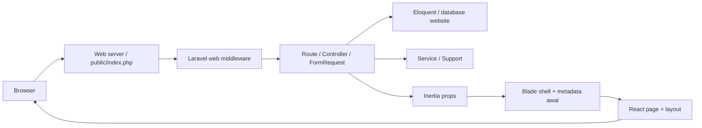

# GPS FOOD — Konteks Proyek, Peta Arsitektur, dan Audit Teknis

Tanggal inspeksi: **25 Oktober 2026 (Asia/Jakarta)**. Repositori: `gpsfood-web`. Baseline Git: `f093da9abc39421470e4f0e218a05dd0d1a34027`.

Dokumen ini merupakan hasil discovery dan review statis, bukan sertifikasi keamanan atau bukti kesiapan produksi. Source code tetap menjadi sumber kebenaran. Nomor baris merujuk baseline tersebut dan dapat bergeser setelah perubahan berikutnya.

Penanda yang digunakan:

- **VERIFIED**: didukung langsung oleh berkas repositori atau pemeriksaan lokal yang disebutkan.
- **DOCUMENTED**: dinyatakan dalam dokumentasi proyek, brief pemilik, atau dokumentasi resmi penyedia; belum berarti terverifikasi di server produksi.
- **PROPOSED**: rekomendasi atau rancangan untuk pekerjaan mendatang; belum diimplementasikan atau disetujui sebagai keputusan final.
- **UNKNOWN**: tidak dapat dipastikan dari inspeksi ini.

Status berlaku untuk butir atau paragraf di bawah label yang sama sampai label berikutnya. Klaim perilaku yang berasal dari pembacaan kode adalah kesimpulan statis; temuan yang belum direproduksi melalui HTTP diberi batasan secara eksplisit.

## 1. Gambaran proyek

**VERIFIED.** Website ini adalah aplikasi monolitik Laravel dengan frontend React/TypeScript melalui Inertia. Laravel menangani routing, session, validasi, query Eloquent, penyimpanan konten, email, dan akses CMS. React merender halaman publik dan panel admin. Blade menyediakan shell HTML dan metadata awal, bukan seluruh badan halaman. Bukti: `public/index.php:14`, `bootstrap/app.php:12`, `routes/web.php:24`, `resources/js/app.tsx:10`, `resources/views/app.blade.php:7`.

Website merupakan company profile dan katalog bisnis, bukan aplikasi transaksi: tidak ditemukan cart, checkout, pembayaran, stok, pembukuan, atau modul TMC dalam route, model, dan migration yang diperiksa. CMS dibuat sendiri dengan controller Laravel dan halaman Inertia; tidak ditemukan Filament, Nova, Backpack, Livewire, atau CMS eksternal sebagai kerangka admin.

**DOCUMENTED.** Domain bisnis adalah `gpsfood.id`; lingkungan deployment yang dijelaskan saat ini adalah cPanel shared hosting tanpa runtime Node persisten (`DEPLOY.md:7`). **UNKNOWN.** Kondisi server, versi yang sedang terpasang, trafik, dan data produksi tidak diperiksa.

## 2. Konteks bisnis

**VERIFIED.** Identitas di konfigurasi adalah CV Gama Putra Santosa, berlokasi di Sleman/Yogyakarta (`config/company.php:6`). Dua brand yang mempunyai seed, model produk, katalog, dan route khusus adalah **Kuicip** dan **Putri Teko**. Seed berisi 8 produk Kuicip dan 14 produk Putri Teko; angka ini adalah isi berkas seed, bukan jumlah data produksi (`database/seeders/data/brands.json`, `database/seeders/data/products.json`).

Nama **Ngayogyakarya** muncul dalam copy perusahaan dan footer (`app/Http/Controllers/HomeController.php:57`, `resources/js/lib/i18n.tsx:288`). Tidak ditemukan seed brand atau katalog khusus untuk nama tersebut. Penyebutan dalam copy tidak membuktikan adanya modul ketiga.

**DOCUMENTED — brief pemilik.** Sistem “Sistem Manajemen Operasional TMC, Keuangan & Pelaporan GPS FOOD” merupakan proyek terpisah. RAB telah diajukan dan menunggu tanggapan klien; implementasinya tidak dianggap telah dimulai. Codebase, database, environment, dan deployment sistem internal harus terpisah dari website ini.

**PROPOSED.** Kuicip — Ruang Cerita, slogan “Teman Ceritamu”, direncanakan pada `/kuicip/cerita`. Ini adalah pengembangan website publik di luar lingkup proyek TMC/Finance. Tidak ditemukan implementasi story submission, moderation, reaction, reporting, Turnstile, atau Supabase pada source aplikasi saat audit.

## 3. Technology stack terverifikasi

**VERIFIED.** Versi berikut dibaca dari lockfile, bukan diklaim sebagai versi runtime produksi.

| Lapisan | Dependensi/alat | Versi yang dikunci / persyaratan | Bukti |
| --- | --- | --- | --- |
| Backend | Laravel | `v12.64.0`; constraint `^12.0` | `composer.lock`, `composer.json:13` |
| PHP | Runtime requirement | `^8.2` | `composer.json:9` |
| Bridge | inertia-laravel / @inertiajs/react | `v2.0.24` / `2.3.27` | Kedua lockfile |
| UI | React / React DOM | `18.3.1` | `package-lock.json` |
| Bahasa frontend | TypeScript | `7.0.2`; strict, noEmit | `package-lock.json`, `tsconfig.json:12` |
| Bundler | Vite / laravel-vite-plugin / plugin-react | `7.3.6` / `2.1.0` / `4.7.0` | `package-lock.json`, `vite.config.js:5` |
| Styling | Tailwind / PostCSS / Autoprefixer | Tailwind `3.4.19` | `package-lock.json`, `tailwind.config.js`, `postcss.config.js` |
| Komponen UI | Headless UI / Lucide | `2.2.10` / `1.26.0` | Lockfile; `Components/admin/Topbar.tsx:3` |
| Animasi | GSAP | `3.15.0`, ScrollTrigger, Draggable, InertiaPlugin | `resources/js/lib/gsap.ts:1` |
| Rich text | TipTap | `3.28.0`, StarterKit, Link, Image | `Components/admin/RichTextEditor.tsx:19` |
| Grafik CMS | Recharts | `3.10.0` | Lockfile; `Pages/Admin/Dashboard.tsx` |
| HTTP frontend | Axios | `1.18.1` | Lockfile; `resources/js/bootstrap.js:1` |
| URL bernama | Ziggy | `v2.6.3` | Lockfile; `resources/views/app.blade.php:73` |
| Gambar | Intervention Image / Laravel integration | `3.11.8` / `1.5.9`, driver GD | Lockfile; `config/image.php:21` |
| Sanitasi HTML | stevebauman/purify / HTMLPurifier | `v6.3.2` / `v4.19.0` | `composer.lock`, `config/purify.php:55` |
| Auth scaffolding | Breeze | `v2.4.2`, development dependency | `composer.lock`, `composer.json:21` |
| API auth package | Sanctum | `v4.3.3`, terdaftar tetapi belum dipakai aplikasi | `composer.lock`, `composer.json:14` |
| QA backend | PHPUnit / Pint | `11.5.56` / `v1.29.3` | `composer.lock`, `phpunit.xml` |

Lockfile Vite dan laravel-vite-plugin mensyaratkan Node `^20.19.0 || >=22.12.0`. Node yang tersedia pada proses audit adalah `v22.20.0`. PHP tidak ditemukan melalui PATH proses pemeriksaan; versi PHP lokal belum dapat diverifikasi. Tidak dilakukan instalasi dependensi.

**VERIFIED.** `npm run build` hanya menjalankan **`vite build`** (`package.json:6`); konfigurasi Vite tidak memasang pemeriksa tipe. Tidak ada script lint, test JavaScript, atau typecheck terpisah dalam `package.json`. Type-check harus dijalankan eksplisit. `@types/react`/`@types/react-dom` memakai major 19 sementara runtime React major 18; kompatibilitas perlu diperhatikan, tetapi satu kegagalan tipe yang teramati dijelaskan di bagian 17.

**DOCUMENTED, bertentangan dengan source.** `docs/PROJECT_DOCUMENTATION.md:11` menyebut Laravel 11. `AGENTS.md:68` dan `CLAUDE.md:38` menyatakan build melakukan type-check otomatis. Gunakan lockfile, script aktual, dan hasil pemeriksaan sebagai acuan; dokumentasi lama tidak diubah dalam tugas ini.

## 4. Struktur repositori

**VERIFIED.** Inventaris berikut membedakan source, dokumentasi, aset, tooling, dan artefak. Keberadaan direktori tidak membuktikan bahwa isinya aktif di produksi.

| Lokasi | Peran dan status |
| --- | --- |
| `app/` | Source backend: controller, request, middleware, model, service, resource, support, enum, command, mail, provider |
| `bootstrap/app.php`, `bootstrap/providers.php` | Registrasi route, middleware, redirect auth, provider |
| `bootstrap/cache/` | Cache/generated service discovery; tidak dibaca sebagai konfigurasi rahasia dan tidak dihapus |
| `config/` | Konfigurasi Laravel dan default company/brand assets; nilai environment aktual tidak dibaca |
| `routes/` | `web.php`, `auth.php`, `console.php`; tidak ada `api.php` |
| `resources/js/` | React Pages, Layouts, Components, hooks, lib, types |
| `resources/css/app.css` | Tailwind directives, font lokal, utility dan styling artikel |
| `resources/views/` | Shell Inertia, XML sitemap, template email kontak |
| `database/migrations/` | 16 berkas migration; skema yang diharapkan, bukan bukti migration telah dijalankan |
| `database/seeders/`, `database/factories/` | Seed brand/product/setting/partner; factory hanya User |
| `public/images/`, `public/fonts/`, `public/favicons/` | Aset statis terkontrol Git, foto WebP, font lokal, ikon |
| `public/uploads/` | Tujuan upload CMS langsung di web root; nama path disimpan pada record, bukan tabel media |
| `public/build/` | Hasil build Vite, diabaikan Git; manifest lokal ada tetapi kesesuaian dengan source saat ini tidak dijamin |
| `public/build.zip`, `public/build (2).zip` sampai `(8).zip` | Delapan arsip build lokal yang diabaikan Git; isi arsip tidak diekstrak/diperiksa. Jika ikut diunggah, dapat diakses langsung sebagai aset publik |
| Dua berkas `public/fonts…` dengan nama menyerupai fragmen perintah | Terlacak Git, header biner `wOF2`, masing-masing 10.672 dan 19.244 byte. Tampak sebagai artefak penamaan/copy font, bukan script; penggunaan belum dibuktikan |
| `public/google*.html` | Aset verifikasi situs; tidak dianggap modul aplikasi |
| `storage/` | Data runtime: log, cache, session, dan disk aplikasi. Isinya tidak dibaca untuk menghindari data pribadi/rahasia |
| `tests/` | PHPUnit, mencakup test aplikasi serta test scaffolding lama |
| `docs/PROJECT_DOCUMENTATION.md` | Dokumentasi lama; dipertahankan |
| `graphify-out/` | Output graph analisis: manifest, graph JSON/HTML, laporan dan cache; diabaikan Git, bukan backend tambahan |
| `logo-mitra/` | Koleksi bahan logo dan daftar per kategori; diabaikan Git. Aset yang dipakai aplikasi berada di `public/images/partners/` |
| `%LOCALAPPDATA%/npm-cache/` | Direktori literal lokal berisi cache npm/npx; diabaikan Git, bukan source. Hanya struktur yang dikenali; dependensi cache tidak dianalisis |
| `testsprite_tests/tmp/config.json` | Satu konfigurasi TestSprite terkontrol Git. Hanya nama key dibaca; tidak ditemukan script/suite E2E di direktori ini |
| `vendor/`, `node_modules/` | Dependensi terpasang; tidak dipindai rekursif. Hanya entry point compiler dan dua file framework spesifik dipakai untuk verifikasi perilaku |
| `.env`, `.phpunit.result.cache` | Konfigurasi privat dan cache test sudah ada; tidak dibaca atau diubah |

`README.md` masih merupakan README bawaan Laravel. `GEMINI.md` menunjuk path workspace lama. Tidak ditemukan direktori `.github` atau konfigurasi CI umum pada root saat inspeksi.

## 5. Arsitektur aplikasi dan lifecycle request

**VERIFIED.** Alur utama:

1. Web server mengarahkan request non-aset ke `public/index.php` (`public/.htaccess:21`). Entry point memuat autoload dan `bootstrap/app.php`.
2. Route `web.php` memakai web middleware Laravel, termasuk session dan CSRF default. Tidak ditemukan pengecualian CSRF aplikasi. Middleware tambahan adalah `HandleInertiaRequests`, preload link headers, dan `TrackPageView` (`bootstrap/app.php:19`).
3. Route admin memeriksa `auth` dan `noindex`; bagian users/settings memeriksa `superadmin`. Route login memakai `guest` (`routes/auth.php:6`).
4. Controller menjalankan query Eloquent dan membangun props. Resource mengubah database bilingual menjadi bentuk `{id, en}`. FormRequest memvalidasi mutation; beberapa request juga memanggil penerjemah sebelum validasi.
5. Kunjungan HTML awal memakai `resources/views/app.blade.php`; `seo` dirender di server, props disertakan ke mount Inertia. `createRoot` React merender badan halaman (`resources/js/app.tsx:21`). Tidak ada entry SSR/hydration aplikasi.
6. Navigasi Inertia berikutnya mengambil respons halaman/props dan mengganti komponen tanpa reload penuh. Aset memakai dynamic page imports.
7. `TrackPageView` mencatat GET publik yang sukses setelah handler mengembalikan respons (`TrackPageView.php:23`). GET aplikasi karena itu tidak selalu bebas efek samping. Membuka pesan admin juga mengubah `is_read`.

Logika bisnis tersebar secara konvensional: controller mengatur query dan penulisan; FormRequest memuat aturan dan batas featured; model memuat scope/relasi/cache; service menangani gambar/translation; Support menangani SEO, sanitasi, kategori, dan parsing user-agent. Tidak ada lapisan repository/domain terpisah, custom job, listener, event class, atau policy di `app/` yang ditemukan.

## 6. Inventaris route dan halaman

**VERIFIED.** Semua route aplikasi di bawah berasal dari `routes/web.php:24` dan `routes/auth.php:6`; health route berasal dari `bootstrap/app.php:16`. Nama controller tanpa namespace admin berarti `app/Http/Controllers/`. Nama komponen di tabel relatif terhadap `resources/js/Pages/`.

| Metode / path | Route name → handler | Model / sumber konten | Tampilan dan tujuan |
| --- | --- | --- | --- |
| GET `/` | `home` → `HomeController@index` | Brand, Product, Article, Partner, Setting + copy statis | `Home.tsx`; hero, profil, mitra, produk, ekspor, berita, kontak |
| GET `/products` | `products.index` → `ProductController@index` | Product featured/active, Brand | `Products/Overview.tsx`; pengenalan dua keluarga brand |
| GET `/products/kuicip` | `products.kuicip` → `ProductController@kuicip` | Product aktif, Brand key kuicip | `Products/KuicipCatalog.tsx`; katalog brand |
| GET `/products/kuicip/{slug}` | `products.kuicip.show` → `ProductController@kuicipShow` | Product scoped brand + related | `Products/ProductDetail.tsx` |
| GET `/products/putri-teko` | `products.teko` → `ProductController@teko` | Product aktif dikelompokkan packaging | `Products/TekoCatalog.tsx` |
| GET `/products/putri-teko/{slug}` | `products.teko.show` → `ProductController@tekoShow` | Product scoped brand + related | `Products/ProductDetail.tsx` |
| GET `/contact` | `contact` → `ContactController@show` | Shared company/Setting + i18n | `Contact.tsx`, `Components/ContactForm.tsx`; info, peta, inquiry |
| POST `/contact` | `contact.store` → `ContactController@store` | ContactMessage, Setting | Validasi, simpan, kirim email sinkron, redirect; `throttle:5,1` |
| GET `/export` | `export` → `ExportController@show` | Copy i18n + shared company | `Export.tsx`, `Components/ExportCTA.tsx`; informasi kemitraan B2B |
| GET `/export/legalitas-sertifikasi` | `export.legality` → `ExportController@legality` | Certification aktif | `ExportLegality.tsx`; logo, dokumen, tanggal berlaku |
| GET `/mitra` | `partners.public` → `PartnerController@index` | Partner aktif | `Partners/Index.tsx`; direktori dan filter kategori di client |
| GET `/news` | `news.index` → `NewsController@index` | Article published | `News/Index.tsx`; daftar seluruh berita |
| GET `/news/{slug}` | `news.show` → `NewsController@show` | Article published + 3 related | `News/Show.tsx`; isi tersanitasi dan metadata artikel |
| GET `/sitemap.xml` | `sitemap` → `SitemapController@index` | Static routes, Product aktif, Article published | `resources/views/sitemap.blade.php` |
| GET `/robots.txt` | `robots` → `SitemapController@robots` | Teks dari controller | Izinkan publik, larang `/admin`, URL sitemap |
| GET `/up` | Health Laravel | Bootstrap framework | Health response; bukan halaman React |
| GET `/admin/login` | `admin.login` → `Auth/AuthenticatedSessionController@create` | Session status | `Admin/Login.tsx`; guest + noindex |
| POST `/admin/login` | handler `store`, tanpa nama terpisah | User, cache RateLimiter | Login, regenerate session, intended redirect |
| POST `/admin/logout` | `admin.logout` → handler `destroy` | Session | Logout, invalidate session/token, redirect login |

Route admin berikut semuanya memakai `auth` + `noindex`. Handler berada di `app/Http/Controllers/Admin/`; UI di `resources/js/Pages/Admin/`.

| Path / metode | Route name / handler | Model | Halaman / alur |
| --- | --- | --- | --- |
| GET `/admin` | `admin.dashboard` / `DashboardController@index` | Product, Article, Partner, ContactMessage, ActivityLog, PageViewDaily | `Dashboard.tsx` |
| GET, PATCH `/admin/profile` | `admin.profile.edit/update` / `ProfileController@edit/update` | User sendiri | `Profile.tsx`, ubah identitas/password |
| GET `/admin/articles`, GET `/admin/articles/new`, POST `/admin/articles`, GET `/admin/articles/{article}/edit`, PATCH/DELETE `/admin/articles/{article}` | `admin.articles.index/create/store/edit/update/destroy` / `ArticleController` | Article | `Articles/Index.tsx`, `Articles/Form.tsx` |
| Pola yang sama pada `/admin/products`, `/new`, `/{product}/edit`, `/{product}` | `admin.products.*` / `ProductController` | Product, Brand | `Products/Index.tsx`, `Products/Form.tsx` |
| Pola yang sama pada `/admin/partners`, `/new`, `/{partner}/edit`, `/{partner}` | `admin.partners.*` / `PartnerController` | Partner | `Partners/Index.tsx`, `Partners/Form.tsx` |
| Pola yang sama pada `/admin/certifications`, `/new`, `/{certification}/edit`, `/{certification}` | `admin.certifications.*` / `CertificationController` | Certification | `Certifications/Index.tsx`, `Certifications/Form.tsx` |
| GET `/admin/messages`, GET/DELETE `/admin/messages/{message}` | `admin.messages.index/show/destroy` / `MessageController` | ContactMessage | `Messages/Index.tsx`, `Messages/Show.tsx`; baca menandai is_read |
| Pola CRUD users: GET list/new/edit, POST create, PATCH/DELETE record | `admin.users.*` / `UserController` | User, ActivityLog | `Users/Index.tsx`, `Users/Form.tsx`; tambahan superadmin |
| GET, PATCH `/admin/settings` | `admin.settings.index/update` / `SettingController@edit/update` | Setting | `Settings/Edit.tsx`; tambahan superadmin |
| POST `/admin/upload` | `admin.upload` / `ImageUploadController@store` | Tidak ada record media | JSON path content/thumb/og atau logo |
| POST `/admin/upload-pdf` | `admin.upload-pdf` / `PdfUploadController@store` | Tidak ada record media | JSON URL PDF |
| POST `/admin/translate` | `admin.translate` / `TranslationController@translate` | Tidak ada | JSON hasil MyMemory |

Tidak ada route publik registration, reset password, email verification, `/login`, `/profile`, atau REST API terpisah. Package Sanctum tidak berarti endpoint API/token telah tersedia. Brand tidak mempunyai controller, menu, atau route CRUD admin, meskipun modelnya database-backed.

## 7. Arsitektur frontend

**VERIFIED.** `resources/js/app.tsx:16` memakai `import.meta.glob` untuk page resolution. Halaman publik memasang persistent `SiteLayout`, yang menyediakan `LanguageProvider`, Header, main, Footer (`Layouts/SiteLayout.tsx:12`). Panel admin memakai `AdminLayout`, Sidebar, Topbar, dan ToastProvider. Login memakai GuestLayout.

Copy statis berada dalam `resources/js/lib/i18n.tsx`; `const en: typeof id` menjaga kesesuaian bentuk dictionary (`:298`). Bahasa default adalah `id`, disimpan di state React (`:593`), tanpa persistensi localStorage/session atau URL bahasa. Reload penuh kembali ke bahasa default. Konten dinamis memakai kolom `_id`/`_en` dan Resource bilingual; pergantian bahasa tidak memanggil endpoint translation.

Header mempunyai menu desktop, submenu ekspor, dan menu mobile dengan `aria-expanded`; menu ditutup ketika URL berubah (`Components/Header.tsx:38`). Footer memakai shared company dan brand. Sidebar admin mendaftarkan menu pada `NAV_ITEMS` (`Components/admin/Sidebar.tsx:18`), menyembunyikan users/settings bagi non-superadmin, dan menyimpan preferensi collapse di localStorage. Menu mobile kustom belum mempunyai penanganan Escape/focus management lengkap yang terlihat di source; perilaku keyboard belum diuji di browser.

Tailwind memakai token warna, breakpoint `sm/md/lg`, grid responsif, utility tombol/container, serta font yang dihosting sendiri. GSAP dipakai untuk reveal, hero, dan drag/marquee mitra; `useReveal` dan hero menghormati `prefers-reduced-motion` (`hooks/useReveal.ts:19`, `Components/sections/Hero.tsx:22`). Tidak ada hasil audit visual/mobile/Core Web Vitals dalam pemeriksaan ini.

**PROPOSED — pola penambahan halaman publik kelak.** Tambahkan route Laravel bernama, handler yang menyiapkan props dan `Seo`, lalu page TSX dengan `SiteLayout`, tipe props, dan `useLang`. Gunakan komponen/utility yang sudah ada. Perbarui dictionary ID/EN, navigation bila dibutuhkan, sitemap sesuai kebijakan index, dan test route/akses/SEO. Metadata crawler wajib dibangun di server; `<Head>` tetap berguna untuk navigasi client, tetapi tidak menggantikan `Seo` pada respons awal. Tidak ada berkas halaman baru dibuat pada audit ini.

## 8. Arsitektur backend

**VERIFIED.** Query publik menyeleksi status publik secara eksplisit: produk `is_active=true`, artikel scope `published`, mitra dan sertifikasi aktif. Detail produk dicari berdasarkan `brand_id` dan slug; artikel belum published tidak ditemukan pada route publik. Home membutuhkan dua Brand seed melalui `firstOrFail`; database kosong belum menyediakan homepage lengkap (`HomeController.php:20`).

Resource penting:

- `app/Http/Resources/ProductResource.php:18`: data katalog bilingual; mengakses relasi `$this->brand->key`, tidak mengeluarkan `image_thumb`/`image_og` ke frontend.
- `app/Http/Resources/ArticleResource.php:21`: body HTML dua bahasa dikemas sebagai satu elemen array `body`; tags publik berasal dari `tags_id`.
- `app/Http/Resources/BrandResource.php:18`: tag, story brand, link katalog. `story_id` pada Brand adalah narasi brand, bukan cerita kiriman pengunjung.

`HandleInertiaRequests.php:39` membagikan `auth.user`, `site.company`, `site.brandAssets`, `site.brands`, flash status/error, dan unread count ketika authenticated. Shared brands selalu diquery; shared settings memakai cache. Model User menyembunyikan password dan remember_token (`User.php:33`).

Service yang sudah dapat dipakai kembali: `ImageProcessor` untuk media dan `TranslationService` untuk copy editorial yang aman dikirim ke penyedia. Support yang penting: `Seo`, `ArticleHtmlSanitizer`, `ArticleCategory`, `UserAgentParser`. Tidak ada alasan teknis dari struktur saat ini untuk mengganti framework atau menulis ulang CMS.

Scheduler hanya mendaftarkan `app:aggregate-page-views`, harian pukul `01:00` (`routes/console.php:12`). Command mengelompokkan seluruh raw hits berdasarkan hari/path, menghitung uniques per path, menulis `page_view_daily`, lalu menghapus raw lebih dari 30 hari (`AggregatePageViews.php:24`). `config/app.php:68` memakai **UTC**; tanpa override scheduler, 01:00 UTC setara 08:00 WIB. Jadwal bisnis yang diinginkan belum dikonfirmasi.

Tidak ditemukan custom queue job atau mail yang di-queue. `ContactMessageMail` memakai trait Queueable, tetapi controller memanggil `send`, bukan `queue`, dan class tidak mengimplementasikan ShouldQueue. Default queue database tidak membuktikan worker dibutuhkan untuk alur yang sekarang.

## 9. Struktur database dan relasi

**VERIFIED dari migration/model, bukan introspeksi database.** Default konfigurasi adalah SQLite; `.env.example:23` juga memilih SQLite. Koneksi MySQL, MariaDB, PostgreSQL, dan SQL Server tersedia sebagai konfigurasi Laravel (`config/database.php:20`). Dokumentasi deployment memilih MySQL. Keberadaan konfigurasi PostgreSQL bukan bukti aplikasi/migration kompatibel PostgreSQL seluruhnya.

Singkatan `m/` dalam tabel berikut berarti `database/migrations/`.

| Tabel | Kolom/constraint penting | Relasi/index dan bukti |
| --- | --- | --- |
| `users` | name, email unique, password, verification timestamp, remember token, timestamps; role enum superadmin/editor default editor | `m/0001_01_01_000000_create_users_table.php:14`; `m/2026_07_24_040000_add_role_to_users_table.php:13` |
| `password_reset_tokens` | email primary, token, created_at | Migration users `:24`; endpoint reset saat ini tidak ada |
| `sessions` | id primary, user_id nullable, **ip_address**, user_agent, payload, last_activity | user_id dan last_activity index; user_id tidak memakai constrained FK (`migration users:30`) |
| `cache`, `cache_locks` | key primary, value/owner, expiration index | `m/0001_01_01_000001_create_cache_table.php:14` |
| `jobs`, `job_batches`, `failed_jobs` | queue/payload/attempts; batch counts; failure exception dan uuid unique | `m/0001_01_01_000002_create_jobs_table.php:14` |
| `brands` | key unique, name, tag_id/en, weight nullable, story_id/en, href | Brand hasMany Product; `m/2026_07_23_155144_create_brands_table.php:11` |
| `products` | brand_id, slug, group, packaging, bilingual name/short/personality/serving/description, highlights/notes JSON, colors, image paths, featured, placeholder, sort_order, is_active | brand FK cascade delete; unique `(brand_id, slug)`; index `(brand_id, featured, group)` dan `(brand_id, packaging)`; `m/2026_07_23_155144_create_products_table.php:13`, tambahan `m/2026_07_24_040600_add_admin_fields_to_products_table.php:11` |
| `articles` | slug global unique, date, category_slug string, bilingual title/excerpt/body/tags, image paths, featured, published default false | index `(published, featured, date)`; `m/2026_07_23_155145_create_articles_table.php:11` |
| `contact_messages` | name, email, topic, message, is_read false, timestamps | Tidak ada retention/soft delete; `m/2026_07_24_030000_create_contact_messages_table.php:11` |
| `partners` | name, category, logo nullable, sort_order, is_active, featured false | index `(category, is_active, sort_order)`; category awal enum lalu string; `m/2026_07_24_040100_create_partners_table.php:11`, `m/2026_07_24_041200_add_institusi_category_and_featured_to_partners_table.php:17` |
| `settings` | key unique, value nullable | Cache invalidation via model event; `m/2026_07_24_040200_create_settings_table.php:11` |
| `activity_logs` | user_id nullable, action, module, item_label, timestamps | FK User nullOnDelete; index `(module, created_at)`; `m/2026_07_24_040300_create_activity_logs_table.php:11` |
| `page_views` | path, viewed_on, browser, device, referrer_domain, visitor_hash SHA256, timestamps | index `(viewed_on, path)`; `m/2026_07_24_040400_create_page_views_table.php:16` |
| `page_view_daily` | date, path, hits, uniques, browser_json/device_json, timestamps | unique `(date, path)`; table name eksplisit pada PageViewDaily; `m/2026_07_24_040500_create_page_view_daily_table.php:16` |
| `certifications` | name, issuer, category, logo, pdf_url, valid_until, sort_order, is_active | Tidak ada FK ke Product/Brand; `m/2026_09_01_080000_create_certifications_table.php:11` |

Total 18 tabel didefinisikan oleh migration di atas; tabel pencatat migration Laravel merupakan tabel infrastruktur tambahan. Tidak ditemukan migration `personal_access_tokens`, tabel media, product category/variant terpisah, story, report, reaction, atau sistem keuangan.

Product belongsTo Brand; ActivityLog belongsTo User. Model lain yang diperiksa tidak memiliki relasi bisnis tambahan. Packaging Putri Teko memakai string tervalidasi enum PHP `TekoPackaging`: botol, kotak, toples, kemasan, besek (`app/Enums/TekoPackaging.php:10`). Group rtd/brew dan kategori partner/artikel diatur daftar nilai di kode, bukan taxonomy yang dapat di-CRUD.

Tidak ada penggunaan `SoftDeletes` pada model yang diperiksa. Delete CMS merupakan hard delete. Aktivasi/deaktivasi disediakan sebagai alternatif untuk beberapa jenis konten, tetapi bukan mekanisme pemulihan record.

Seed: DatabaseSeeder memanggil BrandSeeder, ProductSeeder, SettingSeeder, PartnerSeeder; admin sengaja tidak dibuat otomatis (`database/seeders/DatabaseSeeder.php:10`). Brand/Product seed memakai updateOrCreate sehingga rerun dapat menimpa perubahan CMS pada record seed. SettingSeeder memakai firstOrCreate. Partner seed mengisi aset logo statis dan pilihan featured. Factory yang tersedia hanya UserFactory.

**UNKNOWN.** Migration mana yang telah dijalankan di server, perubahan schema di luar Git, jumlah data, index runtime, backup terakhir, collation dan engine produksi tidak diperiksa. Migration partner memuat SQL `ALTER TABLE ... MODIFY` untuk driver non-SQLite (`:39`), sehingga perpindahan seluruh aplikasi ke PostgreSQL membutuhkan penyesuaian; ini tidak menghalangi database cerita PostgreSQL yang terpisah.

## 10. Arsitektur CMS dan admin

**VERIFIED.** CMS menggunakan pola index/form per modul, route model binding, FormRequest, Eloquent create/update/delete, redirect bernama, dan flash toast. Tidak ada registrasi plugin modul; penambahan menu dilakukan pada `Components/admin/Sidebar.tsx:18`.

Dashboard mempunyai statistik active/total untuk produk, artikel, mitra, pesan; sepuluh aktivitas terakhir; grafik 30 hari; browser/device breakdown; lima path teratas. Relasi user activity di-eager-load (`Admin/DashboardController.php:39`). Sertifikasi belum memiliki kartu statistik tersendiri.

| Modul | Pengelolaan dan publikasi | Batasan penting |
| --- | --- | --- |
| Produk | Data bilingual, brand, group/packaging, warna, foto, featured, active, urutan; pencarian/filter | Semua editor dapat mengubah; tidak ada workflow approval, version history, atau redirect slug lama |
| Artikel | TipTap, gambar cover/inline, tanggal, kategori, tags, featured, published/draft; konfirmasi perubahan slug setelah publish | Featured+published dibatasi 3 lewat query request; bukan constraint concurrency. `published` tidak memeriksa tanggal, jadi bukan scheduled publishing |
| Mitra | Nama, enam kategori termasuk institusi, logo transparan, active, featured, sort | Pilihan featured untuk home berbeda dari semua mitra aktif pada `/mitra` |
| Sertifikasi | Nama, penerbit, kategori legal/halal/bpom/pirt/other, logo, URL/PDF upload, tanggal berlaku, active, sort | Expiry ditampilkan, bukan otomatis menonaktifkan; PDF yang sudah diupload adalah aset publik |
| Pesan | Daftar/filter, detail yang menandai dibaca, delete | Bukan ticketing/reply system; semua akun authenticated saat ini dapat membaca pesan |
| Pengguna | Create/update/delete, editor/superadmin, password; larangan self-delete dan last-superadmin | Akses superadmin. Pemeriksaan last-superadmin berupa check lalu write, belum transactional/locking |
| Pengaturan | Kontak, jam, Instagram, title/meta/default OG | Akses superadmin; sebagian key tidak dikonsumsi tampilan publik, lihat F15 |
| Profil | Nama/email sendiri dan password dengan current_password | Tidak menyediakan self-delete atau verifikasi email |

ArticleValidationRules menolak body kosong, memeriksa kategori, featured cap, dan normalisasi slug. Controller menyanitasi body sebelum simpan (`Admin/ArticleController.php:60`). ImageUploadField dan upload inline menggunakan Axios; AutoTranslateButton menggunakan JSON endpoint. `useUnsavedChangesGuard` menangani beforeunload dan Inertia navigation; ConfirmDialog/DeleteButton memberi konfirmasi penghapusan. Validasi/form error muncul inline; status/error flash menjadi toast pada AdminLayout. Tidak ditemukan inbox notifikasi administratif selain unread message badge, toast, dan ringkasan activity.

**PROPOSED.** CMS dapat menampung halaman moderasi Ruang Cerita melalui layout dan session yang sama. Gunakan controller/request/policy/modul baru yang khusus cerita, menu Sidebar, query yang dipaginasi, dan pencatatan moderation event. Jangan memakai Article sebagai storage cerita: semantik publikasi, privasi, consent, panjang teks, dan auditnya berbeda. Jangan menyalin akses broad `auth` untuk cerita privat tanpa menetapkan izin staf terlebih dahulu.

## 11. Autentikasi dan permissions

**VERIFIED.** Guard `web` berbasis session memakai model User (`config/auth.php:40`). Login memakai email/password melalui `LoginRequest::authenticate`, Auth::attempt dengan remember option, dan session regeneration (`Auth/AuthenticatedSessionController.php:26`). Logout menginvalidasi session dan merotasi CSRF token (`:35`). Password dihash melalui Hash dan cast `hashed`.

Lima login gagal per IP dibatasi selama 180 detik melalui cache RateLimiter (`Requests/Auth/LoginRequest.php:44`). Key hanya IP, sehingga pengguna di NAT yang sama dapat berbagi batas; konfigurasi trusted proxy/infrastruktur nyata belum diketahui. Tidak ada bukti MFA, SSO, public signup, password reset web, account lockout per user, atau email verification workflow.

| Kemampuan | Guest | Editor | Superadmin |
| --- | --- | --- | --- |
| Halaman publik dan kontak | Ya | Ya | Ya |
| Dashboard/profile/content/media/translation/messages | Tidak | Ya | Ya |
| Users/settings | Tidak | Tidak, 403 server-side | Ya |
| Moderasi cerita dan akses cerita privat | Belum ada | Belum ditentukan | Belum ditentukan |

Role gate nyata berada pada route dan `EnsureUserIsSuperadmin.php:18`, bukan sekadar menu tersembunyi. FormRequest kebanyakan mengembalikan authorize true karena mengandalkan middleware route. Setiap endpoint baru harus memasang authorization yang sesuai; reuse FormRequest tanpa route protection tidak cukup.

Default session database, lifetime 120 menit, HttpOnly true, SameSite lax; Secure cookie mengikuti konfigurasi environment (`config/session.php:21`, `:172`). Session payload tidak dienkripsi secara default. Ini adalah default source, bukan nilai aktif produksi. `noindex`/robots merupakan petunjuk crawler dan tidak menggantikan autentikasi.

`admin:create` hanya meng-upsert email, nama, password, tanpa role (`AdminCreateCommand.php:40`). Dengan default migration saat ini, akun baru menjadi editor. Lihat F04 sebelum memakai prosedur bootstrap di deployment baru.

## 12. Fitur bisnis yang sudah ada

**VERIFIED.** Halaman dan pemilik teknisnya dipetakan pada bagian 6. Sumber pengisian konten:

- **Homepage**: urutan Hero → CompanyIntro → PartnersLogoWall → FeaturedProducts → ProductFamilies → ExportPreview → NewsPreview → ContactCTA (`Pages/Home.tsx:48`). Profil, headline, dan banyak narasi berasal dari i18n/config. Produk/berita/mitra dari database. Beberapa slot produk dipilih berdasarkan slug tetap di controller, sehingga featured CMS tidak mengendalikan seluruh kurasi home (`HomeController.php:23`).
- **Profil perusahaan**: bagian `#about`, company info pada contact/footer, dan narasi ekspor. Tidak ditemukan route `/about` terpisah atau page builder.
- **Brand dan katalog**: dua katalog dan detail bersama, related products maksimal 3. Produk adalah presentasi, bukan inventori/penjualan. Foto kosong dapat memakai SVG packshot dari `Components/graphics/` melalui ProductPackshot.
- **Variasi produk**: rasa/SKU berupa record Product terpisah; Putri Teko mempunyai packaging dan group. Tidak ada tabel variant atau kategori produk yang dapat dikelola terpisah.
- **Mitra dan ekspor**: direktori mitra CMS, filter kategori client-side, trust wall home curated, halaman kemitraan statis, CTA ke contact/WhatsApp, dan dokumen sertifikasi CMS. Tidak ada akun distributor atau portal pemesanan.
- **Kontak**: nama/email/topik/message tervalidasi; disimpan sebelum email dikirim. Kegagalan email dicatat tanpa menghilangkan pesan atau menampilkan 500 kepada pengirim (`ContactController.php:31`). Topic hanya divalidasi sebagai string, bukan enum. Tidak ada lampiran, CAPTCHA, cooldown lintas sesi, atau duplicate detection saat ini.
- **Berita**: draft/published, kategori tetap, bilingual rich HTML tersanitasi, tags, featured home, related articles, gambar responsive variants yang dibuat saat upload. Body listing ikut dikirim meskipun kartu hanya membutuhkan ringkasan.
- **SEO**: title, description, canonical, OG/Twitter, Organization/Product/NewsArticle/Breadcrumb JSON-LD, noscript H1/description. Metadata utama tetap Indonesia; tidak ada URL locale/hreflang yang ditemukan. Sitemap mengecualikan draft/inactive; daftar statis belum memasukkan route legalitas (`SitemapController.php:15`).
- **Analitik internal**: pencatatan path publik, referrer domain, device/browser, hash pengunjung per hari; dashboard membaca aggregate. Tidak ditemukan integrasi GA/Meta pixel di source yang diperiksa.

**UNKNOWN.** Kebenaran klaim bisnis dalam copy, validitas dokumen sertifikasi, status hubungan dengan mitra, dan kecukupan persetujuan penggunaan logo tidak diverifikasi oleh audit kode.

## 13. Integrasi pihak ketiga

**VERIFIED.** Integrasi keluar yang jelas dipanggil aplikasi adalah **MyMemory**: Laravel Http client melakukan GET ke API translation dengan teks `q` dan `langpair`, timeout 12 detik per panggilan (`Services/TranslationService.php:21`). Tidak memakai API key pada implementasi ini. Tombol translation dan pengisian bahasa kosong otomatis memanggil service tersebut. Kegagalan mengembalikan teks asal, sehingga respons sukses UI tidak menjamin bahasa benar.

Google Maps dimuat sebagai iframe pada Contact, URL dari config company (`Pages/Contact.tsx:86`). WhatsApp dan email memakai link keluar, bukan bot/API. Ada aset HTML verifikasi Google, tetapi keberadaannya tidak membuktikan Search Console sedang terhubung.

Email memakai Laravel Mail dengan beberapa driver tersedia; default adalah log (`config/mail.php:17`). `config/services.php` memuat placeholder konfigurasi Postmark, Resend, SES, Slack; disk S3 juga tersedia. Tidak ditemukan pemakaian aktif penyedia-penyedia tersebut pada source aplikasi selain konfigurasi generik. Nilai environment aktual tidak dibaca, sehingga penyedia email produksi **UNKNOWN**.

**PROPOSED.** Jangan mengirim cerita privat/sensitif ke TranslationService yang ada secara otomatis. Integrasi Turnstile dan Supabase hanya rancangan pada bagian 21. Pemeriksaan dokumentasi resmi keduanya tidak melibatkan akun, key, atau infrastruktur GPS FOOD.

## 14. Aset, upload, dan storage

**VERIFIED.** Image endpoint memerlukan authenticated session, memvalidasi JPEG/PNG/WebP maksimal 10 MB, context allowlist, dan variant standard/logo; kemudian melakukan decode dan pemeriksaan media type (`Admin/ImageUploadController.php:26`). Driver GD melakukan auto orientation dan strip metadata (`config/image.php:42`).

| Pipeline | Hasil | Bukti |
| --- | --- | --- |
| Standard | UUID-content.webp maksimal lebar 1280 quality 82; thumb maksimal 640 quality 80; og cover 1200×630 quality 82 | `Services/ImageProcessor.php:49` |
| Logo | UUID-logo.webp maksimal 480×480, tanpa crop paksa, transparansi dipertahankan | `ImageProcessor.php:80` |
| PDF | UUID.pdf, maksimal 20 MB, mimes pdf dan actual MIME application/pdf | `Admin/PdfUploadController.php:22` |

Context gambar mencakup products, articles, partners, settings, certifications. Semua ditulis langsung di `public/uploads/{context}`. PDF langsung di `public/uploads/certifications`. File di lokasi ini publik, walaupun upload-nya dilindungi login. Tidak ada antivirus/content-disarm PDF, batas pixel gambar, kuota storage, katalog media, ownership upload, atau orphan cleanup yang ditemukan.

`ImageProcessor::delete` menghapus sibling variant berdasarkan prefix dan mencoba membatasi lokasi ke uploads (`:102`). Pemanggil update/destroy menghapus media lama. Seed image `/images/...` dimaksudkan tetap aman dari penghapusan rutin karena berada di luar uploads. PDF mempunyai logika deletion tersendiri yang lebih lemah, lihat F01. Gambar inline artikel tidak dilacak sebagai relasi media dan tidak dibersihkan otomatis saat body berubah.

`config/filesystems.php:76` mendefinisikan symlink public/storage ke storage/app/public. **DOCUMENTED.** Deployment menjalankan storage:link (`DEPLOY.md:80`). Pipeline upload yang diperiksa tidak bergantung pada symlink tersebut; symlink tetap relevan jika kelak memakai disk public. Status symlink di produksi belum diketahui.

## 15. Temuan keamanan dan privasi

Review mengasumsikan website pemasaran dengan staf CMS terbatas dan trafik wajar; angka beban belum tersedia. Tidak ada eksploitasi, pengiriman form, pembukaan data produksi, atau destructive security test. **Tidak ada Critical yang dapat dikonfirmasi dalam lingkup ini; hal tersebut bukan jaminan tidak adanya kerentanan.** Temuan bernomor diteruskan di bagian 16 dan 19.

### F01 — High — Penghapusan PDF tidak memastikan path tetap di direktori yang diizinkan

**VERIFIED, analisis statis.** Store/UpdateCertificationRequest menerima `pdf_url` sebagai string bebas (`Requests/Admin/StoreCertificationRequest.php:35`, `UpdateCertificationRequest.php:35`). `CertificationController::destroy` hanya memeriksa prefix `/uploads/certifications/`, lalu menggabungkan path dan memanggil unlink (`Admin/CertificationController.php:86`). Segmen parent-directory pada nilai tersimpan dapat melewati prefix tekstual dan mencapai file lain yang writable oleh proses PHP. Editor mempunyai akses create/update/delete sertifikasi.

Dampak: akun editor yang disalahgunakan dapat menghapus file di luar direktori PDF, berpotensi mengganggu aplikasi. Prasyaratnya akun authenticated dan izin filesystem yang memungkinkan; tidak direproduksi dan tidak diklaim pernah terjadi. **PROPOSED perbaikan minimum:** terima hanya path upload PDF dengan basename UUID yang valid atau URL HTTPS yang diizinkan; sebelum delete gunakan canonical realpath, batas direktori dengan separator, dan verifikasi file yang diharapkan. Tambahkan test di filesystem sementara, bukan lokasi upload asli. Validasi scheme URL publik juga harus dilakukan; saat ini link PDF dirender langsung (`Pages/ExportLegality.tsx:100`), tetapi eksekusi script melalui browser tidak diuji.

### F02 — High — Suite upload dapat menghapus media lokal yang bukan milik test

**VERIFIED.** `tests/Feature/Admin/ImageUploadTest.php:20` menghapus seluruh direktori `public/uploads/products`, articles, partners, settings pada tearDown tanpa redirect public_path ke sandbox. Pipeline test juga menulis file ke lokasi yang sama. SQLite memory hanya mengisolasi database, bukan filesystem.

Dampak: menjalankan suite pada checkout berisi media nyata dapat menghilangkan media tersebut. **PROPOSED:** arahkan public/upload root test ke direktori sementara dan hapus hanya resource test. Jangan menjalankan suite ini di workspace berisi media berharga sampai isolasi ditetapkan. Tidak ada file dihapus pada audit ini.

### F09 — Medium — Audit tidak lengkap dan penghapusan pesan menyisakan identitas

**VERIFIED.** ArticleController tidak memanggil ActivityLog, demikian pula perubahan profile dan akses baca konten. ActivityLog hanya menyimpan actor, action, module, label; tidak menyimpan before/after, alasan, atau version (`Models/ActivityLog.php:22`). Penghapusan ContactMessage menyimpan nama/email ke item_label (`Admin/MessageController.php:42`), sehingga delete pesan tidak menghapus seluruh salinan identitas dari aplikasi. Tidak ditemukan retention activity/contact atau log akses cerita privat karena fitur belum ada.

Dampak: dashboard aktivitas bukan riwayat perubahan lengkap; prosedur penghapusan data pribadi harus memperhitungkan log dan backup. Session database juga memiliki kolom IP/user-agent, walaupun tabel analitik tidak menyimpan raw IP. **PROPOSED:** tetapkan retention, gunakan identifier minimum pada audit, dan catat event moderasi/read-private yang dibutuhkan tanpa menyalin isi cerita. Jangan menjanjikan anonimitas tidak terlacak.

### F10 — Medium — Auto-translation mengirim konten ke pihak ketiga sebelum validasi selesai

**VERIFIED.** `AutoTranslatesBilingualFields.php:15` dipanggil pada prepareForValidation untuk produk/artikel dan dapat mengirim bahasa yang terisi ke MyMemory. Request yang nantinya ditolak pun dapat sudah mengirim teks. Pengiriman menggunakan query GET dan exception message dilog oleh service (`TranslationService.php:21`, `:34`). Ini bukan bukti provider menyimpan data atau terjadi kebocoran; kebijakan provider/log aktif tidak diperiksa.

Dampak: draft atau konten sensitif berpotensi keluar tanpa keputusan terpisah operator; pengecualian error dapat membawa detail request ke log. **PROPOSED:** validasi shape/panjang sebelum outbound call, jelaskan transfer kepada operator, dan jangan reuse otomatis untuk cerita privat. Hasil terjemahan tetap perlu review manusia.

### Kontrol yang sudah ada dan batas pemeriksaan

**VERIFIED.** Auth/session regeneration, role gate server-side, CSRF web default, FormRequest, Eloquent parameter binding, upload re-encode, HTMLPurifier allowlist, dan React text escaping adalah dasar yang baik. `dangerouslySetInnerHTML` publik yang ditemukan berada pada body artikel yang melalui sanitizer (`News/Show.tsx:75`). Sanitizer hanya dipanggil controller artikel, bukan mutator model; import/penulisan langsung baru harus menjaga jalur tersebut.

Tidak ditemukan custom API authentication/CORS policy atau API route aktif. Tidak ditemukannya policy bukan bukti CORS terbuka: topologi saat ini same-origin web. Secure cookie, HTTPS/HSTS/CSP, trusted proxy, debug flag produksi, permissions filesystem, log access server, retensi hosting, serta konfigurasi mail adalah **UNKNOWN**. Default `.env.example` berorientasi development dan bukan bukti salah konfigurasi produksi. Tidak dilakukan audit CVE/dependency advisory atau pemeriksaan rahasia dalam `.env`/riwayat Git.

## 16. Temuan performa

### F11 — Medium — Resource produk memicu query relasi berulang

**VERIFIED, statis.** `ProductResource.php:20` mengakses brand. Query produk publik di `ProductController.php:20`, `:39`, `:73` dan `HomeController.php:23` tidak memakai eager loading/setRelation. Resolusi setiap model dapat melakukan query brand tambahan. Daftar admin produk sudah memakai `with('brand')`; sitemap juga sudah eager-load.

Dampak: jumlah query bertambah mengikuti produk/slot, termasuk pada katalog kecil saat ini; tidak ada benchmark latency. **PROPOSED:** eager-load relasi pada query publik atau pasang relasi brand yang sudah diketahui; tambahkan pemeriksaan jumlah query pada alur katalog, tanpa membuat lapisan baru.

### F12 — Medium — Daftar dan payload belum dibatasi

**VERIFIED.** News index mengambil semua artikel dan memakai ArticleResource yang menyertakan body kedua bahasa (`NewsController.php:17`, `ArticleResource.php:30`). Banyak daftar CMS juga memakai get seluruh record, termasuk pesan (`Admin/MessageController.php:24`). Products/partners/sertifikasi publik juga full list.

Dampak: ukuran HTML/JSON dan rendering bertambah tanpa batas ketika artikel/pesan bertambah. Tidak diklaim sudah lambat pada volume sekarang. **PROPOSED:** dahulukan pagination pesan/artikel dan projection ringkasan khusus listing; feed cerita baru wajib membatasi batch di backend, bukan mengambil semua lalu slice di React.

### F13 — Medium — Translation dan email menahan request HTTP

**VERIFIED.** TranslationBatch menjalankan panggilan sinkron per field/baris/blok; timeout 12 detik berlaku per panggilan, bukan total request (`TranslationService.php:50`, `:91`). Endpoint translate tidak membatasi jumlah fields/panjang teks (`Admin/TranslationController.php:17`) dan tidak mempunyai throttle khusus. Pengisian otomatis berlangsung saat submit form. Email kontak juga sinkron, konfigurasi SMTP timeout default null (`ContactController.php:42`, `config/mail.php:48`).

Dampak: banyak blok atau provider lambat dapat melampaui execution time shared hosting dan menahan worker PHP; endpoint translation membutuhkan akun admin, sedangkan contact publik sudah memiliki throttle. **PROPOSED:** batasi ukuran/jumlah, tetapkan timeout total yang masuk akal, tampilkan kegagalan provider dengan jelas. Queue hanya ditambahkan bila benar-benar diperlukan dan worker/cron operasional tersedia.

### F14 — Low — Label unique visitor menjumlah unique per path

**VERIFIED.** Aggregate menghitung distinct visitor_hash per date/path (`AggregatePageViews.php:24`); grafik kemudian memakai SUM(uniques) per date (`Admin/DashboardController.php:65`). Satu pengunjung yang membuka dua path pada hari yang sama dihitung dua pada angka gabungan.

Dampak: angka tersebut bukan unique visitor situs per hari. **PROPOSED:** ubah label agar akurat atau hitung distinct lintas path saat agregasi. Test sekarang hanya memeriksa satu path (`PageViewTrackingTest.php:58`). Data hari berjalan juga belum real-time karena dashboard hanya membaca aggregate harian.

**VERIFIED — karakteristik lain.** Agregasi mengulang semua hari yang masih tersimpan dan menjalankan query browser/device per group, lalu updateOrCreate; biaya bertambah menurut jumlah date/path (`AggregatePageViews.php:31`). Setiap GET publik terukur menambah satu row sinkron; Brand shared diquery pada semua respons Inertia. Setting memakai forever cache dengan invalidasi model, tetapi banyak key nullable dapat memerlukan query ulang bergantung cache null semantics. Tidak ditemukan response cache/CDN integration khusus di aplikasi.

Manifest build lokal mempunyai 45 entry; ukuran file JS mentah terbesar sekitar 407 KB (Form), 399 KB (Dashboard), 352 KB (app), 186 KB (SiteLayout), 108 KB (AdminLayout). Ini bukan ukuran transfer gzip dan bukan hasil build baru. Dynamic page import, WebP variants, font lokal dengan swap/preload, dan reduced-motion support sudah tersedia. ProductResource belum menyalurkan thumb/og ke kartu publik meskipun variannya disimpan. Tidak ada benchmark, load test, waterfall, database explain, atau audit visual yang dijalankan.

## 17. Testing dan quality assurance

**VERIFIED.** Ditemukan 24 file `*Test.php` dengan 102 metode `test_*`, bukan 102 test yang sudah lulus. Unit test hanya ExampleTest sederhana. Feature test meliputi CRUD CMS, role users/settings, navigation/login admin, product active, mitra, sertifikasi, settings fallback, page tracking/aggregation, dan metadata SEO. PHPUnit menggunakan SQLite `:memory:`, array cache/session/mail, sync queue (`phpunit.xml:20`). `Tests/TestCase.php` tidak menambahkan isolasi khusus filesystem/outbound HTTP.

Test scaffolding lama masih mengarah ke `/login`, `/register`, password reset/verification, `/profile`, dan route `dashboard`, sedangkan route itu tidak tersedia (`tests/Feature/Auth/AuthenticationTest.php:15`, `RegistrationTest.php:14`, `tests/Feature/ProfileTest.php:19`). Expected kegagalannya berasal dari ketidakcocokan source, bukan hasil eksekusi suite. `Feature/ExampleTest.php:15` memanggil home tanpa seed/RefreshDatabase walaupun home membutuhkan Brand.

TranslationTest dan test auto-translate produk/artikel tidak mem-fake Http; menjalankannya dapat menghubungi MyMemory (`tests/Feature/Admin/TranslationTest.php:29`, `ArticleCrudTest.php:19`, `ProductCrudTest.php:166`). ImageUploadTest berisiko menghapus media, lihat F02. Test request Laravel biasa melewati CSRF saat runningUnitTests, sehingga test controller upload belum menggantikan test browser CSRF.

Tidak ditemukan JS test runner/linter, PHPStan/Larastan, browser/E2E suite runnable, atau konfigurasi CI. TestSprite hanya mempunyai temporary config. Pint tersedia sebagai formatter PHP. Tidak ada laporan coverage yang dapat dipakai untuk mengklaim persentase cakupan. Belum ditemukan test khusus keamanan sanitizer/XSS, limiter login, PDF traversal/CSRF/browser upload, bootstrap role admin, filter aktif/read, dan concurrency last-superadmin/featured cap.

Pemeriksaan pada audit ini:

| Pemeriksaan | Hasil |
| --- | --- |
| `rtk git status --short --untracked-files=normal` awal | Bersih, tidak ada perubahan pengguna yang terdeteksi Git |
| Pembacaan source/instruksi/lockfile, penelusuran pemanggil, inventaris direktori dangkal | Selesai; tidak ada database dibuka |
| `rtk proxy node node_modules/typescript/bin/tsc --noEmit --incremental false` | **Gagal, exit 1**: TS2322 pada `resources/js/Pages/Admin/Certifications/Form.tsx:199`; nilai `certifications` tidak ada pada union context `ImageUploadField.tsx:18` |
| Percobaan lint PHP `php -l` melalui child process, tanpa bootstrap Laravel | Tidak dapat berjalan: `spawnSync php ENOENT`. Tidak ada file PHP yang boleh dianggap lulus lint dari percobaan ini |
| PHPUnit/Artisan/browser/Pint/build | Tidak dijalankan; alasan keamanan dan batas hanya dokumentasi |

**PROPOSED — validasi lokal kelak.** Perintah typecheck di atas dan `php -l <file.php>` merupakan pemeriksaan tanpa menulis artefak ketika runtime tersedia. Untuk menjalankan test aplikasi, siapkan checkout/sandbox terisolasi: database test memory, public path temporary, mail fake/array, Http fake/preventStrayRequests, serta tanpa production credentials atau config cache produksi. Setelah itu jalankan test terkait sebelum suite penuh. `composer test` juga menjalankan config:clear, `npm run build` menulis `public/build`, dan Pint mode apply mengubah source: semuanya bukan pemeriksaan read-only untuk fase ini. Pint check-only/CI/build dapat dijalankan pada fase pengembangan terpisah dengan dampaknya dipahami.

## 18. Deployment dan infrastruktur

**DOCUMENTED.** `DEPLOY.md:7` menyebut cPanel shared hosting, PHP 8.2.26, MySQL, aplikasi di luar web root, public_html berupa symlink ke public aplikasi, Composer tersedia, dan Node tidak dipasang. Fakta server ini tidak diuji ulang.

Prasyarat PHP menurut `DEPLOY.md:20`: pdo_mysql, mbstring, gd, dom, bcmath, fileinfo, zip, curl, openssl, tokenizer, ctype; ext-intl disebut tidak wajib karena polyfill. GD harus mendukung WebP untuk pipeline gambar. Ekstensi lokal dan server tidak dicek melalui runtime pada audit ini.

Alur deployment yang didokumentasikan: build frontend lokal, upload `public/build`, pull kode, composer install no-dev bila perlu, maintenance mode opsional, migration bila berubah, optimize clear dan cache config/route/view, lalu up (`DEPLOY.md:111`). Setup awal menambahkan seed, storage link, dan admin:create. Berkas `.env` tidak dilacak Git; debug wajib false di produksi menurut panduan. Jangan menyalin nilai development `.env.example` menjadi asumsi keamanan produksi.

**VERIFIED.** `.gitignore` mengabaikan `public/build`, sehingga Git pull saja tidak mengantarkan bundle. Apache/mod_rewrite diasumsikan oleh `public/.htaccess`; path `/public` harus menjadi document root, bukan root repo. Frontend tidak membutuhkan proses Node untuk melayani production yang dibangun saat ini. `composer setup` menjalankan instalasi, key generation, migration, npm install/build, dan karena itu tidak aman sebagai langkah inspeksi (`composer.json:42`).

**DOCUMENTED.** Cron Laravel setiap menit diperlukan untuk agregasi harian (`DEPLOY.md:100`). Backup aplikasi belum otomatis: panduan mengusulkan daily database dump dengan retensi 14 hari dan rsync uploads (`DEPLOY.md:134`). Dokumen tidak membuktikan cron/backup benar-benar sudah dipasang. Salinan rsync tanpa versioning bukan jaminan pemulihan setelah korupsi atau penghapusan. Tidak ditemukan prosedur rollback release/database, restore drill, retention off-site, release artifact manifest bersama backend, atau deployment atomik.

**PROPOSED.** Pada deployment mendatang, pasangkan source commit dan bundle release, lakukan backup terverifikasi sebelum perubahan data, simpan release sebelumnya, serta tentukan rollback yang tidak sembarang menjalankan migration down. Urutan upload bundle lalu git pull pada panduan dapat menghasilkan jendela ketidakcocokan source/aset bila ada request di tengah. Ini risiko prosedural, bukan insiden yang telah dibuktikan.

Worker queue tidak diperlukan oleh custom job saat ini karena tidak ada job yang ditemukan dan mail kontak sinkron. Jika kelak dipakai, dokumentasikan worker/retry/failed jobs dan strategi shared hosting/VPS; jangan mengandalkan keberadaan tabel jobs sebagai bukti worker aktif.

**PROPOSED — shared VPS.** Pisahkan website, API cerita bila ada, dan TMC/Finance dengan database/user database, secret, domain/cookie, direktori deploy, backup, cache prefix, queue, log, dan akun proses/permission yang sesuai. Batasi akses jaringan database dan resource PHP/DB agar lonjakan publik tidak menghabiskan kapasitas internal. Satu VPS tetap berbagi risiko host/resource; isolasi container/user bukan jaminan setara host fisik terpisah. Tidak boleh ada koneksi cerita publik ke database TMC/Finance. Spesifikasi VPS, anggaran, SLA, serta rencana migrasi masih UNKNOWN.

## 19. Keterbatasan dan technical debt

Nomor temuan berikut melanjutkan bagian 15–16; urutan prioritas adalah High terlebih dahulu, kemudian Medium berdasarkan dampak, lalu Low. Rekomendasi tidak diterapkan.

### F03 — Medium — Upload PDF frontend tidak mengirim token CSRF yang tersedia

**VERIFIED, statis.** `Pages/Admin/Certifications/Form.tsx:82` memakai fetch dan membaca meta csrf-token, sedangkan `resources/views/app.blade.php` tidak menyediakan meta tersebut. Tidak ada `_token` atau header X-XSRF-TOKEN pada request ini; fetch tidak memakai interceptor Axios. Middleware CSRF yang terpasang membaca token request/header, bukan sekadar keberadaan session cookie. Pemeriksaan spesifik `vendor/laravel/framework/src/Illuminate/Foundation/Http/Middleware/VerifyCsrfToken.php:149` mendukung alur ini.

Dampak yang diturunkan dari source: upload PDF browser dengan CSRF aktif akan ditolak, umumnya 419, dan UI dapat menampilkan error generik karena mencoba parse HTML error sebagai JSON. Belum direproduksi melalui browser. **PROPOSED:** gunakan Axios seperti image upload yang sudah ada; verifikasi pada browser session nyata di lingkungan test, tanpa menonaktifkan CSRF.

### F04 — Medium — Bootstrap administrator baru menghasilkan editor

**VERIFIED.** `AdminCreateCommand.php:40` tidak mengisi role. Migration role default editor (`2026_07_24_040000_add_role_to_users_table.php:13`) hanya mempromosikan user yang sudah ada ketika migration berjalan (`:19`). Pada database baru, panduan menjalankan admin:create setelah migration; akun pertama tidak dapat membuka users/settings dan belum ada superadmin yang dapat mempromosikannya.

**PROPOSED:** definisikan bootstrap superadmin eksplisit dan aman, bedakan dari reset password akun yang sudah ada, lalu uji pada database sementara. Jangan mempromosikan semua akun baru secara diam-diam. Keberadaan superadmin pada produksi saat ini UNKNOWN.

### F05 — Medium — Build tidak menjadi gate tipe dan satu error sudah teramati

**VERIFIED.** `package.json:6` hanya Vite; `ImageUploadField.tsx:18` belum menerima context certifications walaupun backend menerimanya dan form mengirimkannya (`Form.tsx:199`). Typecheck read-only gagal dengan TS2322. Tidak diklaim upload gambar pasti gagal runtime karena masalah tipe ini.

**PROPOSED:** selaraskan union context dengan pemanggil dan tetapkan typecheck eksplisit dalam workflow validasi. Dokumentasi jangan menyatakan Vite otomatis melakukan pemeriksaan tipe.

### F06 — Medium — Filter Aktif dan Sudah Dibaca selalu memilih false

**VERIFIED, statis.** `Admin/ProductController.php:31` membandingkan `$request->string('status') === 'active'`; `Admin/MessageController.php:20` melakukan pola sama untuk read. Request::string mengembalikan objek Stringable, sehingga strict equality dengan string false. Hal ini diverifikasi pada file framework spesifik `vendor/laravel/framework/src/Illuminate/Support/Traits/InteractsWithData.php:247`.

Dampak: pilihan active menampilkan produk inactive; pilihan read menampilkan pesan unread. UI mengirim nilai tersebut (`Pages/Admin/Products/Index.tsx:77`, `Messages/Index.tsx:38`). Test pesan yang ada hanya memeriksa unread (`MessageManagementTest.php:63`). **PROPOSED:** gunakan nilai string dari input atau toString sebelum membandingkan; uji kedua sisi filter pada perbaikan berikutnya.

### F07 — Medium — Panjang ringkasan/tags artikel tidak sesuai kapasitas schema

**VERIFIED.** Rules excerpt dan tags hanya string tanpa max (`Concerns/ArticleValidationRules.php:32`), sedangkan kolom excerpt/tags adalah string default 255 (`2026_07_23_155145_create_articles_table.php:18`). Counter 70–160 di UI hanya petunjuk (`Pages/Admin/Articles/Form.tsx:10`).

Dampak: input lebih dari kapasitas dapat lolos validasi lalu gagal SQL pada MySQL strict; SQLite test tidak otomatis menunjukkan batas yang sama. **PROPOSED:** samakan batas backend dengan kapasitas dan tujuan UI; uji validasi panjang. Jangan memperbesar schema tanpa kebutuhan konten yang disepakati.

### F08 — Medium — Penghapusan media mendahului keberhasilan perubahan record

**VERIFIED.** Update product/article/partner/certification dan settings menghapus gambar lama sebelum operasi database selesai (`Admin/ProductController.php:121`, `ArticleController.php:101`, `PartnerController.php:60`, `CertificationController.php:64`, `SettingController.php:37`). File, penulisan database, dan audit log tidak atomik. PDF lama saat replace/clear juga tidak dibersihkan oleh update sertifikasi; upload batal dan inline image dapat menjadi orphan.

Dampak: bila penulisan database gagal, record lama dapat menunjuk gambar yang sudah dihapus; storage dapat bertambah dengan file tak terpakai. **PROPOSED:** lakukan penulisan record yang berhasil sebelum cleanup lama dan tentukan lifecycle file sederhana. Transaksi database saja tidak mengembalikan file yang sudah dihapus.

### F15 — Low — Sebagian pengaturan tidak memengaruhi keluaran publik

**VERIFIED.** site_title, meta_description_default, instagram_kuicip, instagram_putriteko dapat disimpan melalui settings, tetapi pencarian pemakaian hanya menemukan form/request/controller/seed/test, tanpa konsumen publik. Seo memakai config company untuk title dan description eksplisit controller (`Support/Seo.php:47`). Jam yang diubah di CMS hanya mengganti ID; EN tetap fallback config (`HandleInertiaRequests.php:85`).

Dampak: operator mengira perubahan title/meta/sosial atau jam kedua bahasa sudah dipublikasikan. **PROPOSED:** hubungkan hanya field yang memang dimaksudkan aktif atau jelaskan keterbatasan UI; jangan menambah sistem settings baru.

### F16 — Low — Dokumentasi dan beberapa artefak tertinggal dari implementasi

**VERIFIED.** Dokumen lama menyebut Laravel 11, build typecheck otomatis, Brand CRUD yang tidak ada, dan single-admin meskipun user management tersedia. `public/images/README.md:4` merujuk content.ts lama dan mengatakan admin belum ada; GEMINI menunjuk path lama. Dua aset font bernama tidak wajar dan banyak arsip build masih berada lokal.

Dampak: agen baru dapat memilih alur salah atau menyimpulkan fitur yang sebenarnya belum ada. **PROPOSED:** gunakan dokumen ini sebagai konteks terverifikasi, kemudian koreksi dokumen lama dalam tugas terpisah. Jangan hapus aset/arsip hanya berdasarkan dugaan; periksa referensi, kebutuhan owner, dan isi dahulu.

### F17 — Medium — Suite belum menjadi bukti regresi yang andal

**VERIFIED.** Ketidakcocokan test auth/profile dengan route, outbound translation tanpa fake, dan belum adanya CI/browser test membuat hasil suite penuh belum bisa diasumsikan sehat. F02 merupakan risiko kehilangan file yang lebih mendesak. **PROPOSED:** isolasi test dahulu, selaraskan test dengan fitur yang memang ada, tambahkan regresi untuk temuan nyata, lalu tetapkan baseline lulus. Tidak perlu menambah framework pengujian untuk sekadar menutup satu bug kecil.

**Informational.** Belum ada moderation history granular, soft delete/recovery, general media manager, approval bertingkat, backup otomatis, kebijakan retensi terpusat, atau API boundary story. Ini adalah batas fitur saat ini, bukan bukti website harus ditulis ulang. Pemeriksaan featured cap/last-superadmin masih berpotensi race saat perubahan paralel; beban concurrency staf belum diketahui, sehingga tidak dinyatakan sebagai insiden.

## 20. Rencana Kuicip — Ruang Cerita

**PROPOSED dari brief pemilik; seluruhnya belum diimplementasikan.** Halaman utama `/kuicip/cerita` harus terpisah dari detail katalog yang sekarang di `/products/kuicip/{slug}`. Route baru tersebut tidak bertabrakan dengan pola route yang ada.

| Kebutuhan | Perilaku yang perlu disepakati dan diuji |
| --- | --- |
| Kirim anonim tanpa akun publik | Tidak meminta registration, nama/email/nomor telepon; tetap jelaskan proses metadata teknis oleh hosting/security |
| Kategori | Allowlist backend; keputusan apakah kategori statis atau CMS-managed belum final |
| Panjang 20–1.500 karakter | Trim/normalisasi dan hitung di server; sepakati definisi karakter Unicode agar UI dan backend konsisten |
| Public/private | Visibility terpisah dari status; pilihan private tidak boleh terpublikasi karena aksi approve biasa |
| ID seperti KC-0006 | Unik dari sequence/ID database, bukan count+1; bukan password untuk membuka cerita privat |
| Moderasi | Default pending; approve/reject oleh staf berizin; alasan dan riwayat transisi tercatat |
| Feed | Hanya approved + public + consent publish + belum dihapus; filter diterapkan di query backend |
| Enam cerita per batch | Limit backend 6 pada awal; cursor/order stabil dan batas maksimum tetap walaupun client meminta lebih |
| Load more / kategori | Reset cursor ketika kategori berubah; jangan mencampur stale response, duplicate, atau story privat |
| Heart reaction | Counter atomik, dedup pseudonymous terbatas, rate limit; tanpa akun tidak dapat menjamin satu manusia satu reaction |
| Community reporting | Alasan terbatas dan panjang tervalidasi, dedup/rate limit, queue review; jangan membuka isi privat lewat endpoint report |
| Admin review laporan | Aksi hide/unpublish/reject dan alasan diaudit; banyak report bukan bukti otomatis pelanggaran |
| Tidak ada messaging/comments awal | Tidak menambahkan endpoint atau UI percakapan publik/privat antar pengguna |

Model konseptual minimum: story (ID internal, display code, category, body plain text, visibility, moderation status, consent fields, timestamps/deletion state), moderation events, reports, dan reaction/dedup records bila dibutuhkan untuk konsistensi. Semua merupakan rancangan, bukan tabel baru dalam repositori. Original submission dan versi publik yang disunting moderator perlu dibedakan bila penyuntingan diizinkan; publikasi perubahan bermakna harus mengikuti consent yang disepakati.

## 21. Usulan arsitektur integrasi

### Perbandingan dua opsi

**PROPOSED.** Rekomendasi berikut merupakan inferensi dari CMS custom, session yang sudah ada, skala marketing website, dan batas hosting dalam repositori; bukan keputusan infrastruktur yang sudah disetujui.

| Aspek | Opsi A — Laravel yang ada + tanggung jawab/storage cerita terisolasi | Opsi B — Frontend website + backend/API cerita terpisah + Supabase PostgreSQL |
| --- | --- | --- |
| Bentuk | Route/controller/request/model/policy cerita dalam Laravel; database cerita khusus melalui koneksi dan user DB terbatas | Inertia tetap menyajikan page; API/Edge Function/service lain menangani mutasi dan data; Supabase project khusus cerita |
| Boundary keamanan | Pisah tabel/tanggung jawab; database/user terpisah memberi batas data, tetapi PHP process yang sama dapat memiliki kedua kredensial | Process/deploy/secret terpisah dapat membatasi dampak; batas melemah bila satu service memakai kredensial luas semua sistem |
| Database isolation | Database terpisah disarankan untuk isolasi lebih kuat; tabel prefix saja lebih lemah; tanpa akses TMC/Finance | PostgreSQL project khusus, tidak berbagi database website/internal; akses API dan grants/RLS dikendalikan eksplisit |
| Kompleksitas | Terendah; memakai idiom Laravel yang sudah ada | Lebih tinggi: kontrak API, token, failure/retry, observability, schema dan deploy tambahan |
| CMS | Langsung memakai session/layout admin; authorization baru tetap wajib | CMS dapat tetap satu antarmuka melalui Laravel backend-for-frontend; server Laravel memanggil API moderasi |
| Auth/authorization | Guard web + izin/policy cerita, batasi read private terpisah dari approve public | Session Laravel bukan otomatis JWT Supabase. Perlu autentikasi antarservice dan scope/actor yang diverifikasi server, bukan role yang diklaim browser |
| Hosting | PHP dan DB kedua sesuai dukungan hosting; tidak memerlukan Node production atau PostgreSQL bila memakai MySQL cerita | Membutuhkan managed backend/Edge Function atau service terpisah yang benar-benar dapat dijalankan; self-host Supabase menambah beban operasional besar |
| Resource | Request publik berbagi worker PHP dengan marketing/CMS; kuota, cache, throttle harus membatasi beban | Beban write/feed dapat dipisah; website tetap dapat menjadi bottleneck jika semua lewat proxy tanpa cache/batas |
| Biaya | Lebih sedikit layanan, tetapi perlu biaya database/backup/monitoring tambahan | Tambahan layanan, network, observability, backup, pengelolaan key dan deploy; harga paket tidak diestimasi tanpa beban/penawaran aktual |
| Performa | Tidak ada hop HTTP antar backend untuk query langsung; database cerita tetap bisa gagal sendiri | Tambahan network latency dan ketergantungan layanan; feed dapat di-cache dan diskalakan terpisah |
| Maintenance | Satu codebase website, modul terpisah jelas; migration cerita hanya menuju koneksi cerita | Dua codebase/release boundary dan dua sistem data; butuh versioning kontrak dan testing integrasi |
| Deployment/rollback | Satu release aplikasi, backup/migration DB cerita terpisah | Koordinasi kompatibilitas frontend/API, deploy masing-masing, rollback dan backup khusus |

**PROPOSED — pilihan awal.** Opsi A dengan database cerita khusus dan least-privilege credentials merupakan pilihan paling proporsional berdasarkan bukti saat ini. Ia menggunakan CMS yang sudah ada dan tidak membutuhkan login admin kedua. Supabase **opsional**, bukan prasyarat fitur. Ini bukan isolasi penuh terhadap kompromi PHP website; jika pemilik membutuhkan boundary proses independen, SLA berbeda, atau perkiraan abuse/traffic besar, pilih Opsi B sejak awal.

Opsi B tidak mengharuskan UI admin baru. Alur yang disarankan bila dipilih: browser admin → route Laravel yang terautentikasi dan berizin → API moderasi terbatas → database cerita. Public submission harus melewati backend yang menegakkan validasi/Turnstile/kuota; jangan memberikan akses insert langsung yang memungkinkan bypass kontrol tersebut. Jangan membagikan password/session admin Laravel kepada Supabase atau menyimpan database TMC/Finance dalam project cerita.

**DOCUMENTED — dokumentasi resmi Supabase.** Publishable key bukan secret; izin data bergantung grants/RLS. Secret key dan legacy service_role berprivilege tinggi dan harus tetap di backend; keduanya tidak boleh masuk bundle frontend. RLS tidak menggantikan authorization aplikasi ketika backend memakai kredensial yang dapat melewatinya. Rujukan: [API keys](https://supabase.com/docs/guides/getting-started/api-keys), [Row Level Security](https://supabase.com/docs/guides/database/postgres/row-level-security), diperiksa 25 Oktober 2026. Klaim ini merupakan dokumentasi penyedia, bukan integrasi yang sudah ada.

### Lapisan anti-spam

**PROPOSED.** Dasar rate limit Laravel dan Http client sudah tersedia, tetapi seluruh kontrol cerita berikut masih perlu dibuat dan diuji.

| Kontrol | Penempatan dan ketentuan |
| --- | --- |
| Validasi murah lebih dahulu | Batasi body request, tipe field, panjang 20–1.500, kategori/visibility/consent; abaikan field status/actor/code dari client |
| Turnstile | Browser memperoleh token; backend melakukan Siteverify dengan secret server, memeriksa success dan hostname/action yang diharapkan. Timeout/error menolak submission baru secara jelas, tanpa menyimpan cerita sebagai accepted |
| Rate limit | Pisahkan limiter submit, reaction, report, feed; cache/limiter yang konsisten antar worker, bukan state JavaScript/process-local |
| Cooldown | Enforcement backend memakai pseudonymous client marker dan sinyal jaringan yang diminimalkan; cookie/localStorage hanya sinyal, dapat dibuang pengunjung |
| Duplicate detection | Normalisasi teks dan hash/HMAC yang sesuai, window terbatas, respons tidak membocorkan keberadaan cerita privat; tentukan collision/false-positive policy |
| Kuota global | Reservation/counter atomik dan limit harian/periodik yang diputuskan owner; check lalu increment terpisah tidak cukup untuk concurrency |
| Pending queue | Semua submission masuk pending, tidak langsung ke feed; private tetap private walaupun approved |
| Retry aman | Idempotency submission di backend agar timeout/retry tidak membuat cerita ganda; jangan menganggap display code sebagai idempotency secret |
| Abuse monitoring | Pantau rejected/429, pending depth, reports, storage, error provider; hindari body cerita atau raw identifier pada log rutin |

**DOCUMENTED — Cloudflare.** Siteverify server-side wajib; widget client saja tidak melindungi endpoint. Token berlaku lima menit dan sekali pakai. Validasi hostname/action serta tangani expiry/replay. Rujukan: [Turnstile server-side validation](https://developers.cloudflare.com/turnstile/get-started/server-side-validation/), diperiksa 25 Oktober 2026. **PROPOSED.** Threshold cooldown/kuota tidak ditetapkan pada audit ini karena belum ada data beban dan kebijakan bisnis; CAPTCHA tidak dianggap pengganti seluruh kontrol.

### Privasi, consent, moderasi, dan rendering

**PROPOSED.** Jangan meminta identitas pengirim untuk fungsi inti. Jelaskan bahwa anonim bagi pembaca/staf tidak sama dengan tidak dapat ditelusuri: session, reverse proxy, hosting, WAF, Turnstile, serta log teknis dapat memproses metadata. Batasi retensi dan akses metadata; hash deterministik analitik bukan jaminan anonimitas kriptografis terhadap penebakan input.

Pilihan publikasi dan persetujuan reuse media sosial harus terpisah, eksplisit, default tidak tercentang, dengan waktu dan versi kebijakan tercatat. Cerita privat tidak boleh berubah publik lewat approval tanpa persetujuan yang sah. Jangan menyalin cerita privat/pending ke shared Inertia props, HTML awal, response cache, search index, sitemap, OG description, email notifikasi lengkap, log, atau analytics path/query yang mengandung isi.

Gunakan serialization allowlist khusus publik dan query filter server untuk feed, reaction/report targets, serta setiap lookup ID. ID berurutan KC-0006 boleh menjadi display identifier, tetapi tidak memberi hak baca privat. Batasi read private pada izin staf khusus; semua editor saat ini tidak otomatis menjadi moderator privat. Tindakan approve/reject/hide/delete dan akses sensitif yang disepakati perlu audit actor, timestamp, alasan, status sebelumnya/berikutnya dengan informasi minimum.

Body awal sebaiknya plain text, dirender sebagai text React dengan preservasi line break; tidak membutuhkan TipTap atau HTML submission. Moderator perlu memeriksa nama/nomor/alamat, tuduhan terhadap orang, konten sensitif, ancaman, dan informasi yang dapat mengidentifikasi pihak ketiga sebelum publikasi. Kebijakan eskalasi, batas usia, jam kerja, serta pesan dukungan untuk konten berisiko memerlukan keputusan owner dan penanggung jawab moderasi. Fitur tidak boleh menjanjikan layanan kedaruratan atau kerahasiaan absolut.

Prosedur deletion harus mencakup unpublish segera, penghapusan/anonimisasi data, cache publik, reaction/report yang terkait, riwayat audit yang dibatasi, backup retention, dan salinan sosial media bila pernah dipakai. Untuk pengirim tanpa akun, tentukan mekanisme verifikasi permintaan deletion, misalnya token acak rahasia yang hanya diberikan sekali dan disimpan hash-nya; display ID saja tidak cukup. Mekanisme final belum disetujui.

## 22. Peta berkas untuk implementasi mendatang

Semua perubahan di tabel ini **PROPOSED**, tidak dilakukan pada audit. Berkas baru yang disebut adalah calon lokasi, bukan klaim keberadaan.

| Kebutuhan | Berkas yang sudah ada / calon titik integrasi | Alasan |
| --- | --- | --- |
| Promosi homepage | `resources/js/Pages/Home.tsx:48`; `resources/js/Components/sections/ProductFamilies.tsx`; `resources/js/lib/i18n.tsx` | Tambahkan CTA/section kecil sesuai desain; HomeController hanya perlu berubah jika memerlukan props dinamis |
| CTA brand Kuicip | `resources/js/Pages/Products/KuicipCatalog.tsx:31`; opsional `Products/Overview.tsx:48` | Halaman brand publik yang nyata adalah katalog ini, bukan route `/kuicip` yang belum ada |
| Route publik `/kuicip/cerita` | `routes/web.php:24`; calon `app/Http/Controllers/KuicipStoryController.php` | Entry same-origin dengan Seo dan query/proxy feed yang aman |
| Halaman cerita | Calon `resources/js/Pages/Kuicip/Cerita.tsx`; reuse `Layouts/SiteLayout.tsx`, PageHeader/utility sesuai UX | Form, kategori, batch 6, load more, heart/report, state error/empty/429 |
| Storage Opsi A | `config/database.php`; calon model/request/migration cerita yang diarahkan ke koneksi khusus | Jangan membuat tabel cerita di database internal atau menjalankan migration default tanpa review koneksi |
| API Opsi B | Calon service `app/Services/StoryApiClient.php` hanya bila benar-benar perlu; `config/services.php` dan `.env.example` untuk nama key | Boundary HTTP, timeout, error, scoped authorization; tidak memakai secret di `VITE_*` |
| Moderasi CMS | `routes/web.php:44`; `Components/admin/Sidebar.tsx:18`; `Layouts/AdminLayout.tsx`; calon Admin/StoryController, policy, Pages/Admin/Stories | Reuse session/UI; akses private dan workflow eksplisit |
| Badges/dashboard/audit | `HandleInertiaRequests.php:58`, `Admin/DashboardController.php`, `Models/ActivityLog.php` | Tambah hanya jumlah yang perlu; jangan menyebarkan isi privat sebagai shared prop |
| SEO | `app/Support/Seo.php:34`, `resources/views/app.blade.php:7`, `SitemapController.php:15` | Metadata halaman utama; keputusan index cerita individual terpisah dan tanpa isi privat |
| Header/footer | `Components/Header.tsx:8`, `Components/Footer.tsx:11`, `lib/i18n.tsx:13` | Link pilihan owner, ID/EN, mobile/keyboard |
| Tipe frontend | `resources/js/types/index.ts` atau tipe lokal page bila hanya satu pemakai | DTO publik minimum; hindari menggunakan tipe record privat di browser |
| Backend validation/abuse | Pola `Requests/StoreContactMessageRequest.php`, `Requests/Auth/LoginRequest.php`; calon request/limiter/Turnstile handler khusus | Reuse fasilitas Laravel; jangan menyamakan quota cerita dengan limiter login |
| QA | Pola `tests/Feature/Admin/*`, `SeoTest.php`, ditambah test cerita pada sandbox | Cakup kebocoran private/pending, consent, akses moderator, limiter, cursor, concurrent counters |

## 23. Risiko dan dependensi

**VERIFIED / UNKNOWN.** Kode inti dan alur utama sudah dipetakan, tetapi tidak ada bukti runtime production, load profile, test suite lulus, backup efektif, atau kesiapan VPS. F01 dan F02 harus mendapat perhatian paling awal dalam tugas perbaikan terpisah. F03–F08 dan F17 mengurangi kesiapan pengembangan/regresi; ini tidak membenarkan rewrite.

**PROPOSED.** Dependensi keputusan sebelum Ruang Cerita: penanggung jawab moderasi, akses cerita privat, consent dan deletion policy, batas abuse/retention, arsitektur A/B, kapasitas hosting, kepemilikan key/provider, dan biaya operasional. Risiko dominan bukan hanya teknologi: kurangnya kapasitas moderator dapat membuat queue menumpuk dan konten sensitif tertangani terlambat.

Opsi A berbagi PHP process website; Opsi B menambah kontrak/secret/provider failure. Database khusus saja tidak membatasi semua dampak kompromi aplikasi. Pemisahan TMC/Finance merupakan batas wajib terlepas dari pilihan cerita. Jangan menambahkan fallback koneksi cerita ke database default saat penyedia gagal.

## 24. Urutan implementasi yang direkomendasikan

**PROPOSED; tidak dijalankan.**

1. Selesaikan keputusan owner pada bagian 25 dan tetapkan scope rilis awal tanpa komentar/messaging.
2. Perbaiki dan uji F01 serta isolasi filesystem/outbound test F02; tutup bug upload, bootstrap, filter, validasi, dan gate tipe yang relevan. Pertahankan perubahan kecil dan terpisah agar dapat direview.
3. Tetapkan baseline QA pada checkout aman, pairing source/build, backup/restore plan, dan kebijakan server log/session.
4. Pilih A atau B berdasarkan boundary yang dibutuhkan; siapkan database/user/secret/deployment cerita yang terpisah dari internal. Jangan sekaligus memigrasikan seluruh website ke PostgreSQL tanpa kebutuhan.
5. Definisikan data, status, visibility, consent, izin moderator/private, public DTO, dan deletion workflow. Tulis test privasi/otorisasi lebih dahulu untuk boundary penting.
6. Bangun submission backend dan anti-abuse: validasi, Turnstile, limiter/cooldown, duplicate/idempotency, quota atomik, pending moderation.
7. Tambahkan modul moderation/report pada CMS yang ada dengan audit, alasan keputusan, dan kemampuan unpublish; verifikasi private tidak pernah lolos ke endpoint publik.
8. Buat halaman publik, category filter, feed batch 6/cursor, load more, reaction/report atomik dan dibatasi; kemudian CTA home/brand/navigation dan metadata.
9. Uji moderation lifecycle, rendering plain text, batas Unicode, private lookup/enumeration, consent, retry, concurrent reaction/submit, provider outage, 429, deletion/cache. Lakukan QA keyboard/mobile dan verifikasi browser CSRF.
10. Lakukan staging dengan data sintetis, ukur query/payload, simulasikan beban yang disepakati, latihan restore/rollback, dan siapkan moderator sebelum rollout terkontrol.

## 25. Pertanyaan yang memerlukan konfirmasi pemilik

**UNKNOWN / keputusan owner mendatang.** Pertanyaan ini tidak menghalangi discovery dokumentasi yang sudah selesai.

1. Apakah rilis awal tetap pada hosting cPanel atau menunggu VPS? Berapa kapasitas, trafik yang diharapkan, budget, dan SLA?
2. Apakah isolasi database dalam proses Laravel cukup, atau wajib API/process independen? Siapa mengoperasikan Supabase bila dipilih, dan di region mana?
3. Siapa boleh membaca cerita privat, memoderasi publik, menangani report, mengubah consent, dan melakukan deletion? Apakah role editor sekarang boleh mendapat akses tersebut?
4. Apa tujuan cerita privat, siapa penerimanya, berapa waktu respons, dan apakah pengirim mendapat cara mengecek status tanpa akun?
5. Kategori, aturan komunitas, batas usia, bahasa kiriman, kebijakan konten sensitif, serta eskalasi moderasi seperti apa yang disepakati?
6. Apakah moderator boleh menyunting isi? Bagaimana persetujuan atas versi publik dan reuse sosial media dicatat serta dicabut?
7. Berapa retention cerita rejected/private/deleted, laporan, dedup identifiers, session, hosting/WAF logs, audit, dan backup? Bagaimana permintaan deletion diverifikasi tanpa akun?
8. Nilai cooldown, kuota global, batas report/reaction, dan toleransi false positive untuk duplicate/NAT berapa yang diterima?
9. Apakah cerita individual akan mempunyai URL/index mesin pencari, atau hanya feed? Kebijakan OG/share dan penghapusan cache sosial media bagaimana?
10. Apakah cron, backup harian/off-site, restore drill, email delivery, secure session, dan superadmin produksi sudah berfungsi? Bukti runtime belum tersedia.
11. Apakah Ngayogyakarya cukup disebut dalam profil atau kelak memerlukan katalog? Ini tidak termasuk implementasi audit/Ruang Cerita saat ini.
12. Apakah fitur cerita akan tetap Indonesia saja atau UI bilingual, dan apakah translation cerita dilarang/dibatasi? Jangan menganggap bilingual website mewajibkan penerjemahan konten privat.

## 26. Aturan dan kehati-hatian untuk agen AI berikutnya

**VERIFIED — batas tugas audit ini.** Baca `AGENTS.md`, instruksi RTK yang dirujuk, `CLAUDE.md`, `DEPLOY.md`, dan source terkait sebelum perubahan. Larangan discovery dari brief pengguna lebih spesifik daripada contoh perintah setup/deploy di dokumentasi: contoh tersebut bukan izin menjalankannya pada fase ini. Format bahasa Indonesia/26 bagian dari permintaan pengguna didahulukan atas format bahasa Inggris dalam panduan audit generik.

Perlakukan dokumen ini sebagai peta, bukan pengganti pemeriksaan diff/source terbaru. Verifikasi status Git sebelum bekerja dan pertahankan perubahan pengguna. Jangan menganggap `Brand.story_id` adalah cerita komunitas, package Sanctum berarti API sudah ada, atau file cache/graph/TestSprite adalah modul bisnis. Jangan membaca/menyalin `.env`, credential, record privat, log, atau backup ke dokumentasi.

Tidak boleh menghubungkan public story ke TMC/Finance, memperluas role akses private hanya di UI, mengandalkan validasi JavaScript, menaruh secret pada bundle `VITE_*`, atau mengirim konten privat ke penerjemah otomatis. Gunakan server-rendered Seo untuk public page. Jangan menjalankan test upload yang belum terisolasi, migration/seeder/reset/cache clear/build/formatter apply hanya untuk mencari tahu keadaan proyek.

Konfirmasi keselamatan pelaksanaan:

- Status Git awal: bersih; target `docs/GPSFOOD_PROJECT_CONTEXT.md` sebelumnya belum ada. Dokumentasi lama dipertahankan utuh.
- Satu-satunya file yang dibuat/diubah oleh tugas ini adalah **`docs/GPSFOOD_PROJECT_CONTEXT.md`**. Tidak ada implementasi aplikasi atau Ruang Cerita.
- Pemeriksaan Git akhir: hanya `?? docs/GPSFOOD_PROJECT_CONTEXT.md`; tracked diff kosong. Validasi memastikan 26 bagian lengkap dan 69 rujukan berkas yang sudah ada valid; tiga calon berkas integrasi memang belum ada dan diberi penanda PROPOSED. Tidak ada berkas validasi tambahan dibuat.
- Pemeriksaan tipe dijalankan tanpa emit/incremental dan menemukan satu error yang sudah ada; percobaan PHP syntax lint tidak dapat berjalan karena executable PHP tidak tersedia pada PATH proses tersebut. Tidak ada klaim test backend lulus.
- Tidak menjalankan PHPUnit, Artisan, migration, seeder, Composer install/update/setup/test, npm install/update/build/dev, Pint, aplikasi/server, pengiriman email, form submission, atau security exploit.
- Tidak menjalankan Git add/commit/push/reset/clean/checkout/pull, deployment, penghapusan cache/artefak, atau perubahan dependency/environment. Tidak membuka database lokal/produksi atau mengakses sistem admin/akun eksternal.
- Sumber di luar workspace yang dibaca hanya permintaan terlampir dan instruksi/skill yang berlaku. Referensi jaringan hanya dokumentasi resmi Cloudflare/Supabase; domain/infrastruktur produksi GPS FOOD tidak dihubungi.

**UNKNOWN yang tetap terbuka:** perilaku aktual produksi, data runtime, security headers/infrastruktur, kapasitas beban, email/cron/backup aktif, recovery, serta hasil suite backend/browser. Proyek sudah cukup dipahami untuk merencanakan pekerjaan berikutnya secara terarah; belum dinyatakan production-ready atau siap merilis Ruang Cerita.

## 27. GPS FOOD V2 — implementasi lokal 25 Oktober 2026

Bagian 1–26 adalah **riwayat audit awal** dan dipertahankan utuh, termasuk temuan dan hasil validasi pada saat discovery. Pernyataan historis bahwa belum ada implementasi tidak menggambarkan snapshot V2. Bagian ini adalah pembaruan bertanggal; tidak menandai seluruh temuan F01–F17 selesai. Permintaan V2 terbaru secara eksplisit memperluas tugas menjadi implementasi Ruang Cerita lokal; larangan implementasi pada fase audit/Phase0 sebelumnya adalah batas historis.

### 27.1 Status dan batas kerja

- **IMPLEMENTED / TESTED lokal**: perbaikan F01–F06 tetap ada; desain, katalog/detail, commerce opsional, CMS SEO, backend/frontend cerita, moderasi, isolasi data dan feature flag diimplementasikan.
- **CONFIGURED LOCALLY hanya di test/harness**: SQLite memori default + koneksi stories memori terpisah; Turnstile dimock, HTTP liar diblokir, mail fake, media/public/storage sementara. Tidak ada koneksi DB lokal bernilai atau produksi yang dibuka. .env nyata tidak disunting.
- **READY FOR STAGING dengan prasyarat**: source dan bundle terkompilasi, automated checks lulus; memerlukan provisioning staging MySQL terpisah dan data sintetis, browser dan provider QA.
- **REQUIRES PRODUCTION SETUP**: DB/user khusus, Turnstile domain, secret abuse, cron/cache/session/logging/backup dan restore diverifikasi. Tidak mengubah hosting/cPanel/VPS atau menghubungkan TMC/Finance.
- **REQUIRES OWNER APPROVAL**: kebijakan privasi/komunitas, reuse sosial, retensi dan eskalasi, petugas moderator dan akses privat, katalog Ayam Geprek, tautan Shopee dan berat per produk yang benar. Cerita produksi **NO-GO**; flag default disabled dan policy approval false.

Runbook operasional lengkap: [GPSFOOD_V2_DEPLOYMENT.md](GPSFOOD_V2_DEPLOYMENT.md). Tidak ada commit, push, deployment atau migration terhadap database nyata.

### 27.2 F01–F06 dan baseline aman

F01 PDF deletion: canonical realpath dan parent directory harus sama dengan public/uploads/certifications, ekstensi PDF dan NUL guard; traversal/symlink keluar root ditolak. ImageProcessor juga memvalidasi canonical upload root dengan batas separator agar folder sibling tidak lolos. F02 TestCase membangun environment, bootstrap, public dan storage sementara sebelum provider/database; database hanya SQLite :memory:, array cache/session, fake mail dan preventStrayRequests. Teardown dibatasi canonical parent sys temp dan prefix unik test. Tidak ada cleanup uploads nyata.

F03 PDF upload memakai axios dan mekanisme XSRF cookie/header Laravel yang ada. F04 admin:create membutuhkan --superadmin eksplisit untuk akun baru; editor yang ada tidak dipromosikan diam-diam dan reset mempertahankan role. F05 certification diterima pada union context ImageUploadField. F06 filter produk/pesan memakai input string sehingga perbandingan dengan query string benar.

Baseline F01–F06 diverifikasi ulang sebelum V2 (103 tests/617 assertions termasuk satu skip symlink). Test bawaan Breeze kemudian disesuaikan dengan rute CMS yang sebenarnya: /admin/login, /admin/profile dan redirect back; register/password-reset/verification/confirmation tidak tersedia dan sekarang diuji tetap tertutup. Tidak menambahkan kembali fitur auth publik yang tidak dipakai. Profil tidak boleh mengubah role melalui mass assignment.

### 27.3 Frontend, brand dan katalog

Archivo Black display dan DM Sans body/UI lokal WOFF2 digunakan lewat CSS/Tailwind, dua font request dengan preload; lisensi OFL disimpan berdampingan public/fonts. Referensi visual Juvee digunakan sebagai arah editorial, tanpa menyalin aset/layout. Halaman referensi Cokelatndalem tidak dapat dibaca oleh alat jaringan; implementasi mengikuti kebutuhan brief dan data repository.

Logo owner public/images/logo/logo-gpsfood.png tetap utuh: 3236×1080 PNG RGBA; empat sudut alpha127 (transparan). config/brand_assets.php, header/footer dan BrandLoader memakai logo proporsional. Favicon asli dipertahankan. Loader kecil delayed250ms, nonblocking, motion-safe; fokus dan reduced-motion CSS ditambah. Layout umum memperbarui tipografi dan CTA tanpa mengganti seluruh section bisnis.

Struktur baru: Components/ProductCatalog.tsx, BrandLoader.tsx, sections/StoryInvitation.tsx; dua halaman katalog memakai pencarian nama, group/packaging dari data, grid1/2/3 kolom, reset/empty state dan Kuicip CTA. ProductSummaryResource menghilangkan description/highlights/notes/Shopee yang tidak dipakai kartu. Relasi brand eager-loaded; related aktif satu brand limit3. Gambar memakai thumb/srcset/contain/lazy; placeholder lama tetap fallback. Browser/responsivitas aktual belum diverifikasi karena browser connector tidak tersedia.

Seed repository berisi22 produk, Kuicip8: Original, Balado, Barbeque, Rendang, Spicy Mala, Seaweed, Truffle, Chili Lime. Ayam Geprek tidak ada di seed. Ini **bukan audit database produksi**. Tidak menambahkan/mengganti varian atau gambar; klaim jumlah Kuicip statis di copy yang tersentuh dihilangkan, count katalog berasal dari produk yang dikirim.

### 27.4 Produk, commerce, CMS dan SEO

Migration default website 2026_10_25_100000_add_commerce_and_seo_to_products_table.php menambah kolom nullable: shopee_url, net_weight, seo_title_id/en, meta_description_id/en, image_alt_id/en. Tidak backfill data. Field opsional yang tidak dikirim form lama dipertahankan; null eksplisit mengosongkan field. Store/Update requests, controller prepareData, model, resource dan form CMS tersambung; advanced SEO collapsible, canonical mengikuti slug/rute lama dan OG mengikuti image_og pipeline yang ada.

ShopeeUrl memvalidasi HTTPS, host allowlist Shopee/shp.ee, tanpa credentials/port asing; CTA tidak tampil bila kosong. Tidak ada link bisnis yang ditebak. productInquiryUrl memakai nomor WhatsApp dari site.company/Pengaturan, validasi nomor dan encodeURIComponent dengan nama/brand produk, fallback contact bila kosong.

HTML awal tetap server-rendered Seo Indonesia canonical. Metadata EN yang diisi CMS dipakai saat UI berbahasa Inggris, fallback ke data yang ada; tidak membuat URL duplikat atau menerjemahkan fiktif. JSON-LD Product/Breadcrumb memakai nilai aktual tanpa harga/stock/rating/offers rekaan. Sitemap menambah halaman legalitas publik; cerita individual tidak punya URL publik dan cerita/admin noindex. Klaim dalam AGENTS.md/CLAUDE.md bahwa Vite melakukan type-check otomatis adalah informasi lama: **harus menjalankan tsc --noEmit terpisah**.

### 27.5 Ruang Cerita — persistence dan privasi

/kuicip/cerita menyediakan informasi saat disabled. Saat flag dan policy approval aktif, UI bilingual menyediakan submission20–1500 karakter plain text, kategori tetap, terms consent, pilihan public/private dan consent publikasi serta reuse sosial yang terpisah. Semua masuk pending. Token penghapusan acak32byte ditampilkan sekali pada respons pertama, hash saja disimpan; UUID retry sama memberi receipt tanpa token ulang. KC-ID berasal dari primary key, bukan COUNT, dan tidak mengotorisasi akses/penghapusan. Token hilang memerlukan jalur bantuan operator yang disahkan.

Koneksi stories (config/database.php) hanya STORY_DB_* tanpa fallback default. StoryDatabase guard menolak konfigurasi kosong dan database website yang sama; SQLite :memory: hanya local/testing. StoryRecord selalu koneksi stories. Migration **terpisah** database/migrations/stories/2026_10_25_110000_create_story_tables.php membuat stories, moderation events, reports, reactions dan limits dengan indeks/feed/foreign keys. Eksekusi hanya --database=stories --path=database/migrations/stories; belum pernah pada data nyata. MySQL/MariaDB SQL/concurrency tetap perlu staging, bukan dianggap terbukti oleh SQLite.

scopePublicFeed mensyaratkan public+approved+publication consent+published_at dan nondeleted. Query kategori dan cursor id dibatasi server enam per batch (fetch7), no-store dan public DTO whitelist. Tidak ada pending/private melalui shared props atau endpoint IDs. Halaman/admin tidak memakai MyMemory untuk cerita. Rendering isi memakai React text node, tidak innerHTML; runtime escaping browser masih NOT RUN.

HMAC fingerprint IP/UA bertanggal memakai secret terpisah; raw IP tidak disimpan pada tabel cerita. Ini dedup harian jaringan/browser, bukan identitas manusia atau janji satu reaction selamanya. Hosting/WAF/provider tetap dapat memproses metadata; UI tidak menjanjikan anonimitas absolut. Public mutation selalu JSON agar error validasi tidak mem-flash isi privat ke sesi website. QueryException pada endpoint cerita diubah menjadi503 generik agar SQL bindings/body tidak masuk application logger. Logging hosting/provider perlu review operator tersendiri.

### 27.6 Abuse, moderasi dan operasional

TurnstileVerifier memanggil Siteverify dengan timeout5 detik; wajib success/hostname/action story_submit cocok. Secret kosong/test production/provider gagal menolak kiriman, tidak ada bypass. Secret tetap backend, site key boleh publik. Kuota default200/hari, cooldown60detik, duplicate body/fingerprint, UUID idempotency dan transaksi/row lock quota untuk serialisasi concurrent retry; Laravel throttle tambahan submission/removal5, reactions/reports20, feed60 per menit. Perlu uji MySQL dan persistent cache/session di staging.

Reaksi insert unique+increment atomik; report reason allowlist, validation/max300, unique fingerprint/story, rate limit dan review manual, tanpa automatic hide dari jumlah laporan. Keduanya hanya menarget publicFeed. Removal harus code+secret hash, respons generik202 dan body direduksi [removed], consent/token dicabut serta soft delete/event. Backup/log retention tetap kebijakan terpisah.

CMS memakai login yang sama: middleware superadmin dan StoryPolicy; editor default403 termasuk private. Sidebar hanya tampil jika enabled+superadmin, tetapi otorisasi tetap backend. Admin/Stories Index paginasi20/filterstatus/private/reports/pending report counter; Show history50/reportspaginasi20, approve/reject/hide dengan alasan/event, report resolve/dismiss. Moderasi tidak dapat mengubah visibility atau consent; approval private tetap private.

stories:prune default disabled, retention90hari configurable, maksimal1000 cerita tua/run dengan cascade, cleanup expired limits/reactions; scheduled02:00 zona aplikasi. Jangan aktifkan sampai owner menyetujui retention dan restore. Tidak ada upload foto/video, komentar, profil publik, user login cerita, Redis atau worker baru.

### 27.7 Bukti QA dan paket lokal

| Validasi aktual | Hasil |
|---|---|
| PHPUnit full suite, --do-not-cache-result | PASS:149 tests/913 assertions,148 lulus,1 skip symlink Windows |
| StoryPlatformTest + ProductExperienceTest | PASS:25 tests/234 assertions |
| TypeScript node node_modules/typescript/bin/tsc --noEmit | PASS |
| Sintaks seluruh58 PHP berubah | PASS |
| Pint --test seluruh58 PHP berubah termasuk untracked | PASS |
| Node commerce.test.mjs | PASS:URL encoding/nomor invalid-kosong/fallback |
| Vite build | PASS:3456modules,18.29detik; manifest+54assets |
| HTTP localhost synthetic harness | PASS:14HTML routes,3aset,detailSEO,feed6+1/filter/privateexclusion |
| Browser desktop/mobile/XSS runtime/interaksi/keyboard | NOT RUN:inventory browser kosong |
| MySQL concurrency/provider/produksi/load/backuprestore | NOT RUN |

StoryPlatformTest mencakup CSRF, guest/editor/superadmin, private approval, pending/private/consent feed, validation plain text/length, JSON tanpa session flash, Turnstile/testkey, quota/cooldown/throttle, idempotency, reports/reactions, deletion, feature off, no fallback dan retention story-only. ProductExperienceTest mencakup rute/resource ringkas, metadata ID/EN, Shopee validation/CMS dan bounded query brand. F01–F06 regression tests tetap ada.

ZIP ignored storage/app/private/releases/gpsfood-v2-build-20261025-165029-b3976330.zip berisi55 entri build/*,556307byte, SHA256 86acba0ca4a6320b4472b919a6cebe824e44fd3955a99036946c63bb948fdad5. Verifikasi baca ulang hash semua entri PASS. Tidak mencakup .env/vendor/node_modules/database/fonts/logo; font/logo adalah aset source wajib ikut rilis. JSON pendamping merekam HEAD baseline, dirty state dan hash228 berkas source/aset sebelum/sesudah build sama. Belum ada commit rilis; harus build ulang sesudah commit yang direview sebelum deploy.

Optimasi bukan benchmark kapasitas: main JS352KB/gzip117KB, shared GSAP156KB/gzip61KB masih beban; rich editor406KB dan chart399KB adalah chunk admin. Katalog belum server pagination karena skala seed22; tambah berdasarkan pengukuran pertumbuhan. Tidak ada klaim PageSpeed/CWV/concurrency. Font URL absolut warning build tetapi HTTP lokal200; kedua file fisik harus ikut source deployment.

### 27.8 Pekerjaan tersisa dan keputusan rilis

Website V2 dapat masuk **staging dengan setup terisolasi dan review**, belum dinyatakan lulus browser atau production-ready. Aktivasi cerita produksi **NO-GO** sebelum prasyarat runbook: DB MySQL khusus/credential terbatas, Turnstile production, kebijakan versi non-draft, moderator/escalation/retention, backuprestore, logging/cache/cron, browser desktop/mobile dan uji concurrency. Review katalog dan tautan commerce oleh pemilik. Temuan audit lain yang tidak termasuk scope ini tetap terbuka sesuai source terkini; jangan menyimpulkan seluruh audit terselesaikan dari hasil F01–F06 atau V2.

## 28. Final local acceptance — 26 Oktober 2026

**CONDITIONAL GO untuk website V2 dengan Ruang Cerita disabled; NO-GO untuk aktivasi cerita.** Ini evaluasi lokal, bukan deployment atau persetujuan produksi. Lihat [laporan acceptance](GPSFOOD_V2_ACCEPTANCE.md) untuk bukti, matriks schema, QA browser manual375/768/1440, daftar Git dan logical commit grouping.

Pemeriksaan ulang TestIsolationTest lulus sebelum upload/suite. Hasil terbaru:157 tests/1064 assertions,156passed dan satu skip symlink Windows; ReleaseReadinessTest baru8tests/151assertions. TypeScript noEmit, Node commerce, sintaks/Pint59PHP, Vite build3456modules/19,48detik, HTTP16HTML defaultoff/79aset dan mode feed cerita sintetis lulus. Browser inventory kosong: visual, console JS, interaksi, mobile dan screenshot tetap NOT VERIFIED. PHP8.2/MySQL runtime/hosting/provider/backuprestore belum diuji.

Acceptance membuktikan data lama dipertahankan migration additive nullable, legacy insert/update kompatibel dengan schema baru, dan halaman baca/form edit mempunyai fallback sebelum migration. **Save CMS dengan kolom baru gagal sebelum migration.** Runbook dikoreksi: aktifkan maintenance memakai code lama sebelum git pull; targeted migration website -> aset/cache -> verifikasi kedua flagfalse -> buka trafik. Jangan mengirim trafik baru dalam jendela schema belum siap. MySQL/MariaDB grammar migration diuji tanpa PDO; belum eksekusi ALTER pada server. Rollback code mempertahankan schema tambahan; down menghilangkan metadata baru dan tidak dijalankan otomatis.

Website defaultoff terbukti berjalan tanpa koneksi stories, flag tidak dapat diubah request publik, mutation/feed/admin diblokir dan prune no-op. Untuk rilis website-only, credential/migration cerita serta Turnstile **tidak diperlukan**. Syarat aktivasi cerita tetap seluruh prasyarat operasional bagian27/runbook.

Hanya enam berkas ditambah/diubah pada acceptance ini: AGENTS.md, CLAUDE.md (koreksi Vite bukan type checker), runbook, append konteks ini, docs/GPSFOOD_V2_ACCEPTANCE.md dan tests/Feature/ReleaseReadinessTest.php. Tidak mengubah code aplikasi, dependency, logo/media atau .env. Seluruh F01–F06 dan implementasi V2 sebelumnya dipertahankan. Bukti hash snapshot228source/aset dan semua55entryZIP kandidat lama masih cocok dengan build baru. Kandidat belum berasal dari commit rilis yang direview; pemilik perlu commit/push/build/paketkan sendiri setelah approval.

Sebelum produksi: terima hasil QA browser termasuk CMS save pada staging disposable; operator cocokkan schema/PHP/ext/flagfalse, uji ALTER MySQL staging dan backuprestore; review source/untracked dan pasangkan SHA commit dengan build. Prosedur cPanel hanya dokumentasi mendatang. Tidak ada commit/push/deploy, migration pada data nyata, akses TMC/Finance, perubahan hosting atau penghapusan media asli. Server QAlocalhost sudah dihentikan. Temuan historis lain tetap tidak boleh dianggap seluruhnya selesai.

## 29. Initial branded splash — 26 Oktober 2026

Owner meminta splash layar penuh menggantikan badge navigasi sebelumnya. Shell Blade meng-include partial splash-styles pada head (CSS kritis dan preload logo lokal) serta partial splash di awal body sebelum #app. Background#FFFFFF, logo owner asli proporsional120px mobile/150px >=768px, tanpa teks/dekorasi/spinner. File PNG tidak diubah.

Logo mulai fade/scale0.94->1 selama280ms setelah load; total reveal+hold minimum400ms, kemudian overlay fade220ms setelah React siap. Boot yang lebih lama tidak mendapat hold branding tambahan. Reduced-motion melewati animasi/hold. Logo error tidak menahan aplikasi yang sudah siap; image/React macet dibatasi timerJS5detik dan fallbackCSS5detik. Tanpa JavaScript, atribut hidden mempertahankan akses noscript; tidak ada display:none pada konten aplikasi/SEO. Fail-safe melepas overlay, bukan memperbaiki aplikasi React yang gagal boot.

BrandLoader sekarang komponen sinyal readiness null pada root app.tsx, melalui effect+requestAnimationFrame setelah commit pertama. Komponen tidak lagi di SiteLayout dan tidak mendengarkan start/finish visit, sehingga tidak membuat badge/splash lain pada navigasi Inertia. Progress bar Inertia yang ada dipertahankan. Tidak ada dependency/library animasi baru, perubahan bisnis produk/CMS/cerita, atau aktivasi flag cerita.

Validasi aktual: Node unit tests7cases PASS (timing, readiness lambat, reduced motion, bootstrap gagal, image terlambat/macet/gagal, event duplikat/dokumen baru); SplashLoaderTest+SeoTest11tests/41assertions PASS; suite penuh160tests/1085assertions,159passed/1skip symlinkWindows; TypeScript noEmit/PHPsyntax/Pint/gitdiffcheck PASS; Vite3456modules/17,77detik PASS. HTTP preview mengonfirmasi satu splash di luar React pada HTML publik/admin, JSON navigasi tanpa splash, logo200 dan storiesoff. Browser inventory tetapkosong: visual/hardrefresh/mobileSafariChrome/reducedmotionruntime/console/hydration **NOT RUN**.

QA manual tambahan: hardrefresh localhost8766 pada375/768/1440 memastikan layar putih dan logo terpusat sebelum halaman; navigasi link normal tidak menampilkan splash lagi; emulate reducedmotion; block app bundle atau logo untuk melihat overlay lepas <=sekitar5detik; disableJS memastikan noscript tetap tersedia; periksa Console dan tidak ada duplicate overlay/scrollbar/layoutshift. Link preview read-only yang diminta owner tetap aktif dengan data uji.

**Artefak ZIP tanggal25Oktober kini historis dan tidak cocok dengan frontend splash terbaru.** Tidak menimpa arsip lama; build terbaru ada di public/build ignored. Buat paket baru dari commit final yang disetujui sebelum deployment, beserta source partial Blade baru. Runbook/acceptance diberi penanda snapshot agar paket lama tidak dipakai dengan shell baru. Tidak ada commit/push/deploy atau perubahan .env/hosting/media asli.

## 30. Persistent localhost preview dan resume — 26 Oktober 2026

Permintaan terbaru mengganti harness GET-only dengan preview lokal persisten. Lihat [GPSFOOD_LOCAL_PREVIEW.md](GPSFOOD_LOCAL_PREVIEW.md) untuk pemulihan interupsi, daftar 21 berkas, setup, keamanan, akun, QA dan cara pakai. Bagian 27–29 serta acceptance sebelumnya tetap riwayat. Instruksi preview GET-only lama tidak lagi berlaku untuk server 8766 yang aktif.

Saat pemulihan, helper awal sudah dibuat sebagian. Setup pertama gagal karena nama method bertabrakan dengan PHPUnit; migration berikutnya tertahan karena Migrator mengganti koneksi default sementara. Website schema sudah terbentuk, migration cerita belum selesai, dan akun masih kosong. Server uji sempat tidak dijalankan karena automatic approval terkena batas penggunaan, bukan keputusan unsafe. Setelah pengguna meminta resume, target database diperiksa dan approval normal tersedia lagi; tidak ada workaround untuk menghindari penolakan.

PHP 8.4.23/Laravel 12 sekarang menjalankan scripts/local-preview-router.php pada 127.0.0.1:8766. State ignored berada di storage/app/private/gpsfood-local-preview, dengan website.sqlite dan stories.sqlite terpisah, key/sessions/cache/uploads sendiri. Environment local dan seluruh path canonical diverifikasi sebelum mutation. Database, .env dan upload utama tidak dipakai. Guard menolak file preview pada production. Default enabled/policies_approved tetap false; hanya bootstrap development mengaktifkan flags dalam memory, dengan policy version LOCAL-DEMO-NOT-APPROVED dan banner fiksi. Verifier server tetap dipanggil melalui HTTP fake yang terbatas pada profil; token salah ditolak, HTTP luar diblokir dan mail di-fake.

Migration website dan migration cerita dengan koneksi/path eksplisit selesai. Lima belas fixture idempoten mencakup sembilan public approved serta pending/private/reviewed/rejected/hidden, reactions/reports dan body sampai 1.490 karakter. Dua record fiksi QA tambahan tersimpan, satu sudah soft-deleted lewat token. Setup ulang tidak menggandakan atau menimpa keputusan moderator; fixture yang dihapus juga tidak dibuat ulang. Feed 6+3 dan ID tetap sama setelah restart proses server.

Alur HTTP backend persisten lulus: CSRF 419, verifier 422/202, pending/retry/cooldown, login QA superadmin/editor, editor 403, 17 halaman CMS, approval ke feed, reaction/report, private tetap private, dan removal token. Password QA hanya berada di RAM/stdin dan akun QA dibersihkan. Akun pemilik belum dibuat karena pengguna memilih menjalankan prompt setelah pekerjaan selesai. Command aman ada di panduan; entrypoint menolak overwrite email yang sudah ada dan password pada argv. Hidden prompt tidak fallback ke input terlihat. Login pemilik sendiri NOT RUN.

Dua bug terkonfirmasi diperbaiki: bucket rate limit setiap jenis endpoint cerita dipisahkan agar feed tidak menghabiskan kuota POST, dengan batas numerik tetap; pending report counter mengecualikan cerita soft-deleted. Perbaikan minor CMS menggunakan PNG logo asli pada login/sidebar, menyesuaikan ukuran logo sidebar collapsed, dan menambahkan banner lokal. Tidak ada redesign CMS; font DM Sans/Archivo, cream surfaces, tombol dan focus styles dipertahankan. Visual browser 375/768/1440 NOT RUN karena inventory kosong. Tidak ada klaim screenshot, console, runtime atau layout lulus.

Validasi akhir: 164 PHPUnit tests/1.126 assertions, 163 passed dan satu skip Windows; targeted guard/prompt 7 tests/29 assertions; Node splash 7 cases dan commerce assertions; TypeScript noEmit; PHP syntax/Pint 12 berkas; git diff check — semuanya PASS. Vite build: 3.456 modules/15,67 detik. Penolakan index.php/.env/private-storage dan Host produksi diuji melalui koneksi localhost saja; gpsfood.id tidak dihubungi. Seluruh F01–F06 dan splash dipertahankan.

Tidak ada commit, push, deployment, perubahan hosting/TMC, akses data produksi atau penghapusan media asli. Profil ini development-only dan membutuhkan dependency dev; jangan menyalin state atau menjalankannya di hosting. Aktivasi cerita produksi tetap NO-GO.

## 31. Story preview cards dan modal — 26 Oktober 2026

Kartu lama menampilkan seluruh body tanpa batas dan grid menyamakan tinggi satu baris. Kartu baru memisahkan StoryCard/StoryDetailModal, memakai CSS line-clamp-5 dengan area lima baris (leading-6/7,5rem) dan action di bawah. Grid satu kolom mobile, dua pada md dan tiga pada lg dipertahankan. Tidak ada pemotongan string, schema baru, perubahan maxlength atau mutation data preview.

CTA Baca selengkapnya membuka controlled Dialog dari Headless UI 2.2.10 yang sudah terpasang. Modal mempunyai category/code/title, close button data-autofocus, description aksesibel, area baca keyboard-scrollable, max-height 85vh dengan 85dvh bila didukung, dan wrapping kata panjang. Dialog primitive menangani Escape, backdrop, focus trap/restore dan background scroll lock. Trigger difokuskan sebelum open agar restore juga tepat saat klik Safari. Fade 150ms memakai motion-reduce:transition-none. Perilaku DOM/browser tetap perlu QA manual; ini implementasi, bukan klaim visual teruji.

Body utuh berasal dari DTO feed publik yang sudah ada, tanpa endpoint/request detail baru. React text node mempertahankan paragraf dan meng-escape HTML; tidak ada dangerouslySetInnerHTML. Scope backend public/approved/consented/nondeleted dan semua gate tidak diubah. State supports/busy/message tinggal di StoryCard dan controlled StoryActions yang sama dirender pada card/modal. Open/close tidak mengirim reaksi atau request. Card key tetap id sehingga state tidak direset hanya karena modal dibuka ulang. Filter/load-more/submission/removal tidak diubah.

Berkas task: resources/js/Components/StoryCard.tsx (baru), StoryDetailModal.tsx (baru), Pages/Kuicip/Cerita.tsx, types/index.ts, tests/frontend/story-cards.test.mjs (baru), tests/Feature/StoryPlatformTest.php (regresi teks feed 1.500 karakter), serta append konteks dan panduan local preview.

Validasi: frontend Node 5 tests PASS dengan React server rendering/controlled element wiring untuk teks pendek/sedang/1.500, kartu campuran/long berturut, escaping/paragraf, selected modal/open/close callback dan controlled action/count. Ini bukan DOM/focus/browser test. TestIsolation 2 tests/13 assertions PASS sebelum StoryPlatform 23 tests/174 assertions PASS. TypeScript noEmit, PHP syntax/Pint dan git diff check PASS. Vite 3.458 modules/14,36 detik PASS; CSS clamp 5, viewport cap dvh dan overflow-wrap:anywhere ada dalam build. HTTP preview 8766/kuicip/cerita merespons 200. Browser inventory kosong: visual 375/768/1440, ellipsis nyata, Escape/backdrop, focus cycling/restore, scroll lock dan reduced-motion runtime NOT RUN.

Tidak ada dependency baru, migration, setup/reset database, perubahan moderasi/flags, deployment, commit atau push. Data preview dan F01–F06/splash dipertahankan. ZIP historis tidak mewakili bundle baru; tetap perlu build/package source final sebelum rilis.

## 32. Rilis final, Shopee dan otorisasi Git — 26 Oktober 2026

Brief terbaru pemilik mengizinkan commit/push upstream yang ada dan ZIP final setelah push; tidak mengizinkan deployment atau akses produksi. Perubahan sebelumnya F01–F06, V2, splash, story card/modal dan preview terisolasi dipertahankan. Kartu cerita tetap lima baris; modal memakai Headless UI dan body asli tanpa request saat dibuka.

Shopee: config company.shopee_storefront memuat URL resmi persis https://shopee.co.id/gpsfood?categoryId=100629&entryPoint=ShopByPDP&itemId=49919300654 . ProductResource memprioritaskan override HTTPS allowlist valid, lalu fallback valid. Katalog kedua merek mengirim URL resolved pada summary dan menampilkan anchor terpisah dari detail. Detail Shopee utama + WA sekunder; tidak mengubah row produk atau membuat Offer/stok. Validator CMS yang sama dipakai kembali saat membaca data untuk melindungi dari nilai lama invalid.

Bukti pemeriksaan rilis dicatat pada laporan final: tes PHP terarah story/privacy/product/CMS/splash, frontend story/modal/splash/commerce, TypeScript noEmit, build, diff dan HTTP lokal. Browser visual/focus/scroll mobile belum terverifikasi karena konektor browser kosong. React rendering statis pada harness commerce bukan SSR produksi dan bukan bukti hidrasi browser.

Produksi STORIES_ENABLED=false dan STORIES_POLICIES_APPROVED=false, tanpa DB/migration cerita. Runbook deployment diperbarui: backup -> maintenance dengan bypass privat operator -> fast-forward ke SHA release -> migration produk eksplisit -> ZIP sesuai SHA -> cache -> verifikasi dalam maintenance -> up. Lihat GPSFOOD_V2_DEPLOYMENT.md. Runtime SQLite/key/session/QA/ZIP tetap ignored, tidak masuk commit. SHA/push/ZIP/hash aktual harus diambil dari hasil operasi, bukan perkiraan.

## Ruang Cerita — persiapan soft launch unlisted, 26 Oktober 2026

Baseline bersih671ee9603dcc2da048cb821355e36a529494a91d; redesign V2.1 sudah dibatalkan dan tidak dimasukkan. Promosi homepage/footer/katalog Kuicip dilepas, tanpa mengubah desain korporat lainnya. Halaman cerita tetap memakai SiteLayout dan noindex,nofollow; sitemap tetap mengecualikannya. Sidebar superadmin yang sudah ada dipakai ulang.

Stage A (enabled=true, policies_approved=false) sudah didukung middleware: admin tersedia setelah DB khusus siap, semua endpoint publik tertutup503. Gate halaman/API kini sama untuk versi produksi non-draft yang tidak kosong/maksimal80karakter. Retention days dari config dan kontak email privasi ditampilkan dalam panduan. Default flag tetap false; tidak ada policy approval produksi oleh agen.

Guard DB diperbaiki karena Migrator sementara memakai default=stories: bandingkan nama DB dengan seluruh koneksi SQL website, bukan default sementara; DB_URL website juga diparse tanpa koneksi. Nama stories wajib berbeda secara konservatif termasuk alias host. Semua model/schema tetap memakai stories. Jadwal prune otomatis dihapus; retensi manual memerlukan persetujuan owner dan backup.

Pengujian terfokus dan batas aktual dicantumkan dalam laporan akhir rilis. Tes meliputi Stage A, gate produksi, Turnstile error/replay, authorizations/moderation/consent/privacy, persistent temporary SQLite reconnect, no promo pada markup React dan sidebar role/flag. Tidak mengubah database/env/CMS nyata, tidak memakai SQLite demo untuk produksi. Browser connector kosong; QA visual, PHP8.2/MySQL, Turnstile asli dan operator acceptance produksi belum diverifikasi.

Lihat [runbook soft launch](GPSFOOD_STORIES_SOFT_LAUNCH.md) untuk backup/preflight, privilege DB terbatas, source/build yang cocok, migration stories dengan path eksplisit, Stage A/B, policy/moderator gates dan emergency disable. Commit/push origin/main hanya untuk source yang lolos checks; tidak ada deployment otomatis.

## Anti-spam first-party untuk soft launch — lokal, 26 Oktober 2026

Permintaan terbaru owner mengganti kewajiban Cloudflare dengan provider local eksplisit, tetap mempertahankan turnstile opsional dan menolak provider tidak dikenal. Baseline clean e39cef2896837675670bedd7b3622eae5c09e504. Produksi dilaporkan pemilik pada Stage A dengan DB/admin siap; agen tidak mengakses hosting atau mengubah flag/env/data.

StoryAntispam mengeluarkan nonce/token MAC Laravel yang bound session, jawaban penjumlahan hanya pada cache server, TTL300detik, minimum age2detik, tiga tebakan, atomic cache lock, honeypot server dan throttle challenge10/menit. Local verification dijalankan sebelum query cerita; cache grant sesudah jawaban benar hanya menerima retry idempotent UUID/hash yang sama. Semua quota/cooldown/duplicate/moderation/consent/private/removal protections tetap.

Provider default kode tetap turnstile untuk kompatibilitas; .env.example dan helper preview memilih local secara eksplisit. Production local memerlukan session/cache file atau database persistent dengan lock; tidak ada mode none/disabled atau migration baru. StoryVerification merender soal/renewal lokal atau widget opsional, tanpa mengubah card/modal/nav/home/footer/catalog.

Tidak commit/push/deploy atau membuat ZIP rilis pada task ini. Build lokal dan targeted tests saja; panduan upgrade di GPSFOOD_STORIES_SOFT_LAUNCH.md menggantikan kewajiban Cloudflare untuk provider local. Retensi/prune tetap manual sesuai approval owner, dan Stage B tetap menunggu approval operasional.
